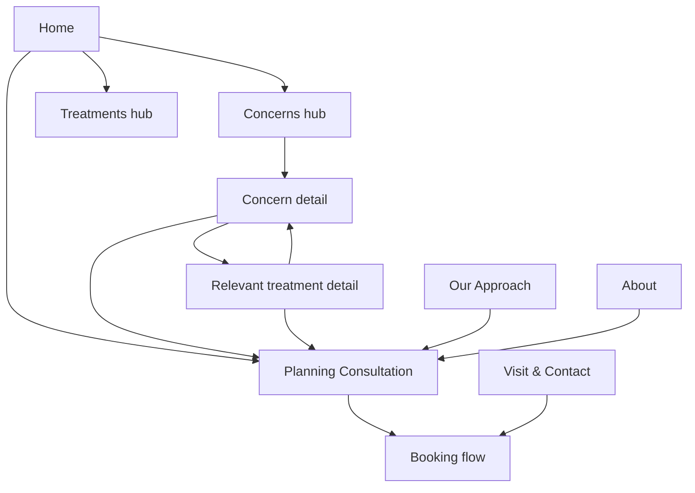

# Juniper House Skin & Aesthetics — Project Strategy

Living strategy document for the portfolio project. Approved decisions are marked **Locked**; unvalidated ideas are marked **Hypothesis**.

## Stage 1 — Project brief

**Status: Locked — 13 August 2026**

### Business

- **Name:** Juniper House Skin & Aesthetics (renamed from Aureline Skin Clinic in Stage 4)
- **Location:** Austin, Texas
- **Model:** Premium consultation-led aesthetics and skin-health clinic
- **Positioning:** Expert, personalized treatment planning for people who want healthier skin and natural-looking results without pressure, confusion, or a cold clinical experience
- **Brand promise:** Expert guidance. Personalized care. Results that still feel like you.
- **Primary conversion:** Book a consultation

### Initial services

1. Advanced skin consultations
2. Personalized facials and skin treatments
3. Laser and light-based treatments
4. Skin rejuvenation treatments
5. Subtle injectable treatments

### Website objective

Move a visitor from “I know what I want to improve, but I am uncertain what to do” to “This clinic understands my concerns, appears qualified, and gives me a safe first step.”

### Central hypothesis

If the website leads with personalized expert guidance, addresses treatment anxiety, and makes consultation booking feel like a safe first step, more qualified visitors will feel ready to contact the clinic.

---

## Stage 2 — Ideal customer

**Status: Locked — 13 August 2026**

This profile is a strategic hypothesis for a fictional business, not a claim based on completed primary research. It will guide research, messaging, page hierarchy, and design decisions, then be refined as evidence is gathered.

### Primary audience: the considered improver

The primary customer is a 30–45-year-old Austin-area professional who has started noticing a persistent skin concern or an age-related change and is ready to seek professional help. They have disposable income and already spend on personal care, but they are selective rather than impulsive.

They want to look refreshed, healthy, and like themselves—not visibly “done.” They may know treatment names from social media, friends, or prior research, but they do not feel qualified to choose one. Their real need is trustworthy guidance.

Demographics help set the context, but the defining traits are behavioral:

- Invests in quality when expertise and value are clear
- Researches providers before making contact
- Compares credentials, results, reviews, treatment philosophy, and experience
- Prefers credible explanations over trends or hype
- Wants an individualized recommendation
- Is willing to follow a treatment plan when the reasoning is clear
- Values convenience, discretion, comfort, and predictable communication

### Representative persona

**Name:** Maya, 37  
**Role:** Marketing director  
**Location:** Central Austin  
**Life context:** Busy professional with an active social life. She maintains a skincare routine, exercises, and spends selectively on wellness and appearance. She is comfortable paying more for an expert but dislikes feeling sold to.

Maya has become increasingly bothered by uneven tone, early lines, and skin that looks tired despite using good products. She has considered laser treatment or injectables, but conflicting advice makes her hesitate. She worries about downtime, unnatural results, and choosing a clinic based on polished marketing rather than clinical judgment.

She does not arrive thinking, “I need a specific device or product.” She arrives thinking, “I want to look fresher, but I need someone trustworthy to tell me what is appropriate.”

### Jobs to be done

**Core functional job**  
When I notice a skin or appearance concern that home care is not resolving, I want an expert to assess it and recommend an appropriate plan so I can make progress without guessing.

**Emotional job**  
Help me feel informed, safe, and in control of the decision.

**Social job**  
Help me look healthy and refreshed while still appearing natural to other people.

### Desired outcomes

- Understand what is causing or contributing to the concern
- Know which treatment options are suitable and why
- See realistic improvement without losing natural expression or identity
- Minimize unnecessary treatment, risk, and downtime
- Have a clear plan, cost expectation, and next step
- Build an ongoing relationship with a clinic that remembers their goals

### Trigger moments

The customer is most likely to begin searching when:

- A recurring skin concern no longer responds to products
- A photograph, mirror moment, birthday, or life transition makes a change more noticeable
- An event or season creates a deadline for improvement
- A trusted friend shares a positive treatment experience
- They become tired of spending on products without a coherent plan
- They are ready to explore professional treatment but do not know where to start

The website should support thoughtful planning rather than encourage treatment immediately before an event.

### Anxieties and objections

1. **“Will I still look like myself?”** Fear of obvious, excessive, or generic results.
2. **“Can I trust this provider?”** Concern about qualifications, safety, judgment, and commercial incentives.
3. **“How do I know what I need?”** Confusion caused by overlapping treatments and trend-driven content.
4. **“What will it really cost?”** Concern that the consultation will lead to an open-ended or high-pressure plan.
5. **“What is the recovery like?”** Need to understand discomfort, side effects, downtime, and scheduling implications.
6. **“Will it work for me?”** Desire for relevant proof across skin types, ages, and concerns.
7. **“Will I be judged?”** Sensitivity about appearance and discomfort with flaw-focused sales language.

### Decision criteria

In likely priority order, the primary customer evaluates:

1. Provider expertise, credentials, and safety
2. Natural-looking, relevant results
3. Personalized and honest recommendations
4. Quality of reviews and word of mouth
5. Clear explanation of treatment, recovery, risks, and expectations
6. Warmth and comfort of the experience
7. Transparent pricing or at least useful price guidance
8. Convenient location, scheduling, and communication
9. Visual quality and professionalism of the brand

The website’s premium visual design earns initial attention, but proof and clarity earn the booking.

### Current alternatives

Before choosing Juniper House, the customer may:

- Continue experimenting with premium skincare products
- Visit a dermatologist for a medical concern
- Compare other med spas or aesthetics clinics
- Ask friends for recommendations
- Follow an injector or aesthetician discovered through social media
- Book a familiar facial as a lower-risk option
- Delay the decision because the category feels confusing or risky

The most important competitor is often indecision, not another clinic.

### Likely customer journey

1. **Concern:** Notices a change or unresolved issue.
2. **Exploration:** Searches by concern, asks friends, or encounters clinic content.
3. **Evaluation:** Reviews philosophy, credentials, results, reviews, services, pricing, and logistics.
4. **Reassurance:** Looks for evidence that the clinic is safe, honest, inclusive, and aligned with natural results.
5. **Commitment:** Books a consultation when the process feels clear and low pressure.
6. **Preparation:** Wants to know what to expect and how to prepare.
7. **Treatment plan:** Chooses an initial treatment or phased plan with the provider.
8. **Retention:** Returns when progress is visible, communication is consistent, and recommendations remain credible.

### Information needs before booking

The website should answer:

- Can this clinic help with my concern?
- Who will assess or treat me, and are they qualified?
- What does “natural-looking” mean in practice?
- What happens during the consultation?
- Will I be pressured to purchase treatment?
- What might treatments cost?
- What are the likely risks, discomfort, and downtime?
- Are the results shown realistic and relevant to me?
- Where is the clinic, when is it open, and how soon can I book?

### Secondary audiences

#### Skin-first optimizer, 25–34

Interested primarily in acne, pigmentation, texture, prevention, and building an effective skin plan. More likely to discover the clinic through search or social content and may enter through facials, peels, or laser treatments. More price-aware, but willing to pay for a plan that replaces ineffective product experimentation.

#### Established maintainer, 40–55

Already familiar with professional treatments and seeking a highly trusted long-term provider. Values consistency, discretion, clinician expertise, efficient appointments, and conservative treatment planning. May have higher lifetime value and greater interest in combined or maintenance plans.

The primary website journey will be designed for the considered improver. Secondary audiences should recognize themselves without forcing the site to support three competing messages.

### Not the priority customer

Juniper House is not primarily designed for:

- Bargain hunters choosing mainly by discount
- Customers seeking extreme or trend-led transformations
- Visitors expecting guaranteed or immediate results
- People needing diagnosis or treatment of urgent medical conditions
- Customers who want to self-select high-risk treatments without consultation

This does not justify exclusionary language or an unwelcoming experience. It clarifies the behavior and expectations the offer is built to serve.

### Messaging implications

- Lead with concerns and desired outcomes before technical treatment names.
- Present consultation as valuable expert guidance, not an administrative hurdle.
- Use calm, specific explanations rather than aspirational vagueness.
- Show the reasoning behind recommendations and set realistic expectations.
- Make provider credentials, safety standards, and treatment philosophy easy to find.
- Use proof responsibly: representative results, appropriate context, and no guarantees.
- Provide useful price guidance and explain what affects final cost.
- Describe booking, consultation, treatment, and aftercare as one coherent experience.
- Avoid insecurity-based copy, urgency pressure, and exaggerated anti-aging claims.

### Experience principles

1. **Guide before selling.** Help visitors make sense of their options.
2. **Reassure without minimizing.** Address risks and anxiety plainly.
3. **Make expertise visible.** Do not require visitors to infer credibility from aesthetics.
4. **Preserve agency.** The customer should feel in control at every step.
5. **Be premium through clarity.** Thoughtful detail and restraint matter more than decorative luxury cues.

### Research assumptions to validate

The riskiest assumption is that uncertainty about choosing a treatment is strong enough that a consultation-led message will outperform service-led or results-led positioning.

Other hypotheses:

- Natural-looking results are a stronger motivator than dramatic transformation.
- Clear price guidance increases trust without reducing qualified inquiries.
- Provider credibility matters more than clinic ambiance once serious evaluation begins.
- Visitors prefer entering by concern rather than by treatment technology.
- A consultation feels like a safe first step only when its value, price, and process are explicit.

### Suggested lightweight validation

For a portfolio project, conduct five short interviews with people who fit the primary behavioral profile and have considered or purchased professional skin or aesthetic treatments. Ask about their most recent decision rather than requesting opinions about the fictional concept.

Use those conversations to validate:

- What triggered their search
- How they compared providers
- Which fears delayed action
- What information was missing from clinic websites
- What finally created enough trust to book
- How they feel about consultations and price visibility

Until validated, fabricated quotes, statistics, and research claims should not appear in the case study.

### Stage 2 decisions to lock

- **Primary audience:** The considered improver
- **Primary age/context:** 30–45, Austin-area professional with disposable income
- **Central motivation:** Look healthier and refreshed while remaining recognizably themselves
- **Central barrier:** Uncertainty about treatment choice and provider trust
- **Primary decision:** Book an expert, low-pressure consultation
- **Secondary audiences:** Skin-first optimizer and established maintainer
- **Content entry point:** Concerns and goals first; treatment names second

---

## Stage 3 — Competitive and market research

**Status: Locked — 13 August 2026**

### Research scope and limitations

This is a directional scan for a fictional portfolio project, not a complete commercial feasibility study. It examines five relevant Austin competitors, national category data, Texas regulatory guidance, and selected public customer conversations. Website content can change, review anecdotes are not representative samples, and competitor claims have not been independently verified.

The research focuses on what will affect Juniper House's positioning, information architecture, copy, and conversion experience:

- How clinics describe themselves
- Which promises and proof signals are common
- How visitors are guided toward a treatment or consultation
- How pricing, risk, downtime, and provider qualifications are communicated
- Where the market feels crowded or undifferentiated
- Which customer questions remain insufficiently answered

### Executive summary

Austin is a mature and competitive aesthetics market containing national med-spa chains, large physician-led dermatology groups, spa-med-spa hybrids, and independent boutique clinics. Most competitors already claim personalized plans, natural-looking results, experienced providers, advanced technology, and complimentary consultations.

This means Juniper House cannot credibly differentiate through those phrases alone. Its strongest opportunity is to make **decision clarity** the product: organize the website around concerns, explain how clinicians make recommendations, show who is suitable for what, publish meaningful price and downtime guidance, and explicitly protect the visitor from pressure and overtreatment.

The largest direct threat is Austin Skin & Wellness because its current messaging already centers on consultation, personalized plans, budget, and no-pressure guidance. Juniper House will need to express its strategy more rigorously through the full customer journey rather than relying on a similar homepage promise.

### Market signals

- The American Med Spa Association reported 10,488 U.S. medical-spa locations in 2023, up from 8,899 in 2022. It also reported that 81% were single-location businesses. This supports the credibility of a premium independent-clinic concept while confirming a crowded and growing category.
- AmSpa reported that 89% of medical-spa patients were women, 54% of female patients were 35–54, and 73% of patients were repeat visitors. Juniper House's primary audience and eventual retention-oriented treatment planning are therefore directionally aligned with reported category behavior.
- AmSpa reported an average spend of $527 per medical-spa visit. This reinforces the need to reduce perceived risk before asking for a booking and to design for an ongoing relationship, not a single impulse purchase.
- The American Society of Plastic Surgeons reported that U.S. neuromodulator injections grew 4% in 2024 and skin resurfacing grew 6%. Both sit within Juniper House's intended service mix, although national procedure counts should not be presented as Austin demand data.
- Texas guidance makes provider identity, licensing, supervision, consultation, medical records, and treatment suitability substantive trust issues rather than decorative credibility content. The website must clearly distinguish aesthetic services from medical cosmetic procedures and avoid implying that all services can be performed by the same type of provider.

### Competitive set

#### 1. SkinSpirit Austin

**Market role:** Premium multi-location med-spa chain with strong injectables and skincare recognition.

**Observed positioning:** “Austin's leading med spa,” combining medical-grade skincare, long experience, artistry, expertise, personalized plans, confidence, and natural results. It offers a free consultation and direct online booking.

**Strengths**

- Twenty-year heritage claim and multi-location scale
- Detailed provider profiles with credentials and treatment specialties
- Strong emphasis on artistry plus medical expertise
- Convenient online booking and extended hours
- Broad range of injectables, facials, lasers, and combination plans

**Vulnerabilities and openings**

- “Personalized,” “natural,” and “expert” are heavily used rather than distinctive
- The breadth of services can create choice complexity for newcomers
- The Austin location page includes testimonials attributed to other cities, weakening local relevance
- Provider-led credibility is strong, but the first-time visitor still needs help understanding which path fits their concern

**Implication for Juniper House:** Do not compete on polish or the phrase “natural results” alone. Make the recommendation process more tangible and locally specific.

#### 2. Viva Day Spa + Med Spa

**Market role:** Established spa and med-spa hybrid competing on medical expertise, relaxation, convenience, breadth, and offers.

**Observed positioning:** The best of a relaxing spa and qualified medical aesthetics under one roof. Viva explains its medical team, supervising physicians, Texas consultation process, financing, and treatment logistics in considerable depth.

**Strengths**

- Clear medical-director and practitioner credentials
- Useful FAQs covering consultation, clearance, financing, insurance, and booking
- Long opening hours, weekend availability, several locations, and online booking
- Unusually visible treatment pricing on selected pages
- Strong promotional system, packages, referral offers, and new-client incentives

**Vulnerabilities and openings**

- Large service catalogue and frequent promotions can feel transactional
- Discount messaging competes with premium medical positioning
- The hybrid spa/medical identity may blur the distinction between relaxation and clinical decision-making
- Users are frequently directed into named treatments and specials before fully understanding suitability

**Implication for Juniper House:** Match Viva's practical clarity without adopting its promotional density. Use restrained value communication and clear starting-price guidance.

#### 3. Westlake Dermatology & Cosmetic Surgery

**Market role:** Large physician-led dermatology and plastic-surgery group with substantial clinical breadth and authority.

**Observed positioning:** Comprehensive medical dermatology, cosmetic dermatology, lasers, research, and plastic surgery across 22 Texas locations. Credibility comes from board-certified specialists, clinical research, scale, and extensive educational content.

**Strengths**

- Strongest clinical authority in the set
- Extensive provider credentials and specialist access
- Large educational content footprint and broad search visibility
- Medical, cosmetic, laser, and surgical options within one organization
- Financing, insurance information, online scheduling, and multiple locations

**Vulnerabilities and openings**

- Breadth makes navigation and category choice more complex
- Institutional scale may feel less personal to someone seeking boutique guidance
- Medical and cosmetic pathways coexist, which can make the first step less emotionally approachable
- Exact cosmetic pricing often requires consultation

**Implication for Juniper House:** Do not imitate institutional authority. Establish a narrower scope, visible clinical governance, and a calmer, more personal decision experience.

#### 4. Austin Skin & Wellness

**Market role:** Independent West Lake Hills med spa combining aesthetics and wellness.

**Observed positioning:** Personalized, honest, medically supervised care with natural-looking results. Its three-step process begins with a consultation, creates a plan around needs, timeline, and budget, and explains aftercare. It explicitly says the first appointment is mostly a conversation with no pressure to book immediately.

**Strengths**

- Clearest consultation-led journey in the competitive set
- Directly addresses uncertainty about choosing a treatment
- Emphasizes budget, rationale, expectations, and no pressure
- Experienced-provider narrative and accessible tone
- Virtual consultation option

**Vulnerabilities and openings**

- Skin, body, injectables, and total wellness create a broad identity
- Several category-standard phrases remain prominent: premier, confidence, natural results, and personalized care
- The visible experience still needs strong supporting proof to make the positioning ownable
- Useful pricing appears less prominent than the consultation message

**Implication for Juniper House:** Treat this as the closest strategic competitor. Juniper House must go deeper with concern-led architecture, explicit suitability guidance, clinician decision criteria, and clearer price/downtime expectations.

#### 5. Austin Med Spa

**Market role:** Long-established boutique med spa near downtown Austin.

**Observed positioning:** Since-2004 heritage, advanced technology, personalized consultation, boutique care, and refreshed rather than overdone results.

**Strengths**

- Long local operating history
- Clear association with natural-looking outcomes
- Broad but recognizable service categories
- Boutique and welcoming framing
- Location relevance for several affluent Austin neighborhoods

**Vulnerabilities and openings**

- Homepage messaging relies heavily on category-standard claims
- Treatment categories and technologies lead the experience
- “Advanced,” “personalized,” “safe,” and “natural” need more visible proof and specificity
- Less differentiation in the described consultation mechanism

**Implication for Juniper House:** Translate philosophy into concrete customer protections and a more useful education experience.

### Messaging comparison

| Dimension | SkinSpirit | Viva | Westlake Dermatology | Austin Skin & Wellness | Austin Med Spa | Juniper House opportunity |
|---|---|---|---|---|---|---|
| Primary frame | Premium med spa | Medical expertise + spa experience | Comprehensive clinical authority | Personalized aesthetics + wellness | Established boutique med spa | Clear decisions for considered clients |
| Main promise | Confidence and natural results | Natural results in a relaxing setting | Specialist access and breadth | A plan built around the individual | Refreshed, never overdone | Understand what is right, why, and what to expect |
| Consultation | Free | Complimentary medical consultation | Complimentary for selected services | Central first step; no pressure | Personalized consultation | A defined, valuable decision service |
| Proof emphasis | Provider profiles, heritage, testimonials | Medical team, awards, detail | Credentials, scale, research, education | Experience, process, reviews | Heritage, team, technology | Credentials + recommendation logic + relevant proof |
| Pricing style | Limited visibility in initial scan | Strong on selected service pages; frequent specials | Consultation/financing-led | Limited visibility in initial scan | Limited visibility in initial scan | Honest ranges and cost drivers |
| Likely friction | Choice overload | Promotional clutter | Institutional complexity | Closest message overlap | Generic category language | Must prove claims despite being fictional |

### Category conventions

These patterns are common enough that they should be treated as expected table stakes rather than differentiation:

- “Premier,” “leading,” “best,” or award language
- Natural-looking or refreshed results
- Personalized treatment plans
- Advanced or medical-grade technology
- Free or complimentary consultations
- Practitioner portraits and credential biographies
- Before-and-after imagery and testimonials
- Broad treatment menus organized by technology or product name
- Persistent “Book now” calls to action
- Monthly specials, memberships, packages, and financing
- Neutral palettes, spacious layouts, polished lifestyle photography, and clinical-spa hybrids

### Customer-language signals

Selected public discussions are anecdotal, but they consistently illuminate the emotional shape of the decision:

- Austin users recommend individual providers as often as clinics, suggesting the practitioner relationship is a major trust and retention asset.
- Honesty is frequently described as a provider being willing to say no or recommend less treatment.
- Natural-looking results, experience, credentials, reasonable pricing, and personal attention recur in recommendations.
- Negative discussions often involve pressure, unexplained product bundles, unclear prices, unsuitable recommendations, or a mismatch between the customer's actual concern and the sales response.
- Customers seek transparent unit or session costs even when total plans vary.

These observations support Juniper House's direction but do not replace interviews or statistically representative research.

### Strategic white space

The available opening is not a new treatment category. It is a better way to choose within an existing one.

#### Opportunity: decision clarity as the premium experience

Juniper House can reframe the category from **shopping for procedures** to **building the right skin and aesthetics plan**.

This should be expressed through:

- Navigation by concern and desired outcome, with treatment names available as a secondary path
- A consultation page that explains deliverables, clinician role, duration, price, and whether the fee is credited
- “Why this may fit / why it may not” guidance on treatment pages
- Realistic timelines, treatment counts, downtime bands, maintenance needs, and starting price ranges
- Provider pages explaining credentials, scope of practice, philosophy, and who performs each service
- A visible no-pressure and no-overtreatment commitment
- Educational comparison content for commonly confused options
- Proof grouped by concern and treatment plan, not isolated dramatic images
- A plan-based follow-up journey that makes ongoing care feel coherent rather than subscription-driven

### Positioning map

Two useful axes for this market are:

- **Horizontal:** Treatment shopping → Guided decision-making
- **Vertical:** Promotional/value-led → Premium/clinical trust-led

Viva occupies strong value, convenience, and education territory. Westlake owns institutional clinical authority. SkinSpirit owns scalable premium polish. Austin Skin & Wellness is closest to guided boutique care. Juniper House should sit at the most deliberate end of **premium, guided decision-making**, with proof delivered through clarity rather than claims of exclusivity.

### Threats and constraints

1. **Positioning overlap:** Consultation-led, personalized, and natural are already claimed locally.
2. **Proof deficit:** A fictional clinic has no genuine clinicians, patients, reviews, operating history, awards, or outcome data.
3. **Trust sensitivity:** This is a medically adjacent, high-consideration category where attractive design without credible detail can reduce trust.
4. **Scope creep:** A large catalogue would recreate competitor complexity and make the fictional business harder to execute convincingly.
5. **Price competition:** Specials and memberships are common, but entering that race would weaken Juniper House's intended position.
6. **Regulatory accuracy:** Provider roles and claims must be researched carefully before publishing treatment copy.

### Strategic responses

- Build only a focused, credible initial service mix in Stage 5.
- Make the consultation a paid or creditable expert service rather than defaulting to a generic “free consultation.”
- Do not invent testimonials, credentials, awards, outcome statistics, or patient histories for the public portfolio site.
- Clearly label the deployed experience as a fictional portfolio concept while keeping the in-world design commercially realistic.
- Use demonstration copy and responsibly sourced or commissioned imagery; do not imply that model images are real patients.
- Treat price transparency, treatment suitability, and recovery information as conversion features.
- Use one primary call to action and a secondary “explore by concern” route.

### Content and SEO opportunities

Later keyword research should validate exact demand, but the competitive scan suggests useful concern-led clusters:

- Uneven tone and sun damage in Austin
- Fine lines and early skin aging
- Acne marks and texture
- Redness and visible vessels
- Dull or dehydrated skin
- “Which treatment is right for me?” comparisons
- Consultation, recovery, cost, and treatment-timeline guides
- Texas sun exposure and seasonal treatment planning

Avoid building a high-volume blog merely to imitate Westlake. A small number of high-intent, decision-support resources will better demonstrate conversion strategy and remain achievable.

### Stage 3 decisions to lock

- **Market category:** Premium independent aesthetics and skin-health clinic
- **Competitive strategy:** Reframe treatment shopping as guided decision-making
- **Primary differentiation:** Decision clarity made tangible across the full website
- **Trust strategy:** Visible qualifications, provider roles, suitability, process, price ranges, downtime, and responsible proof
- **Consultation direction:** Valuable expert service; exact paid/creditable structure to be set in Stage 5
- **Navigation direction:** Concerns first, treatments second
- **Promotional stance:** Restrained; no dependence on recurring discounts
- **Scope stance:** Focused service mix rather than an exhaustive catalogue
- **Closest direct competitor:** Austin Skin & Wellness
- **Proof policy:** No fabricated reviews, credentials, awards, results, or statistics

### Sources

Primary and industry sources:

- [SkinSpirit Austin](https://www.skinspirit.com/locations/austin)
- [Viva Day Spa + Med Spa](https://www.vivadayspa.com/med-spa/)
- [Viva treatment specials and pricing](https://www.vivadayspa.com/specials/)
- [Westlake Dermatology & Cosmetic Surgery](https://www.westlakedermatology.com/)
- [Austin Skin & Wellness](https://www.austinskinandwellness.com/)
- [Austin Med Spa](https://www.austinmedspa.com/)
- [American Med Spa Association: 2024 State of the Industry recap](https://www.americanmedspa.org/news/2024-medical-spa-state-of-the-industry-executive-report-recap/)
- [American Society of Plastic Surgeons: 2024 statistics](https://www.plasticsurgery.org/news/plastic-surgery-statistics/)
- [Texas Department of Licensing and Regulation: Medspas at a Glance](https://www.tdlr.texas.gov/media/pdf/Medspas-at-a-Glance.pdf)

Directional community sources:

- [Austin discussion: med-spa recommendations](https://www.reddit.com/r/Austin/comments/1rk48qa/best_medspas_in_austin/)
- [Austin discussion: injectors and laser providers](https://www.reddit.com/r/Austin/comments/1juwabh/aesthetician_injector_lasers/)
- [Skincare discussion: pressured consultation](https://www.reddit.com/r/SkincareAddiction/comments/125v6kx/felt_pressured_at_a_med_spa_yesterday_personal/)
- [Skincare discussion: unclear laser pricing](https://www.reddit.com/r/SkincareAddiction/comments/1051s4c/)

---

## Stage 4 — Brand positioning

**Status: Locked — 13 August 2026**

### Naming recommendation

**Recommended brand name:** Juniper House  
**Descriptive name:** Juniper House Skin & Aesthetics  
**Formal category descriptor:** Skin health and medical aesthetics clinic

The previously approved name, Aureline Skin Clinic, should be retired. Current web research found multiple active skincare and beauty businesses using Aureline, including “Aureline Skin.” A second invented-name direction, Avelune, was also found across multiple active skincare stores. Continuing with either would weaken search distinctiveness and make the fictional brand feel less carefully researched.

“Juniper House” is warmer, more grounded, and more memorable than a conventional invented luxury name. It complements Austin's natural and design-conscious character without leaning into rustic wellness branding. “House” suggests an ongoing place of care and expertise rather than a transactional treatment outlet. The descriptive lockup supplies the category clarity the name alone does not provide.

An exact-phrase web search did not reveal an obvious skin or aesthetics clinic operating under “Juniper House Skin & Aesthetics” at the time of research. This is sufficient for a fictional portfolio concept, but it is not legal or trademark clearance and should not be represented as such.

### Strategic territories considered

#### 1. Natural-results specialist

Focus on subtle, conservative aesthetic outcomes that preserve identity.

**Advantage:** Emotionally resonant and highly relevant to the audience.  
**Weakness:** Nearly every premium competitor claims natural-looking results.  
**Decision:** Keep as an important benefit, not the primary position.

#### 2. Long-term skin-health partner

Focus on coordinated plans, maintenance, and the relationship between professional treatments and home care.

**Advantage:** Supports retention and a broader skin-health narrative.  
**Weakness:** Can become generic and may sound like a membership model before trust is earned.  
**Decision:** Use as a supporting pillar and customer outcome.

#### 3. The clinic for considered decisions — recommended

Focus on helping thoughtful clients understand what is appropriate, what is unnecessary, and what to expect before committing.

**Advantage:** Directly addresses the primary customer's central barrier and turns market white space into a service experience.  
**Weakness:** Requires unusually clear content and operational proof; the claim fails if the site becomes another treatment catalogue.  
**Decision:** Adopt as the lead strategic territory.

### Positioning statement

For thoughtful Austin adults who want healthier skin or subtle aesthetic improvements but do not want to guess which treatment they need, Juniper House is the premium skin health and medical aesthetics clinic that turns concerns into clear, personalized care plans. Unlike treatment-led med spas, it explains suitability, trade-offs, cost, timing, and expected outcomes before asking clients to commit.

This is an internal positioning statement, not homepage copy.

### Brand essence

**Considered care.**

Every recommendation, interaction, and design choice should feel deliberate, proportionate, and centered on what is appropriate for the individual.

### Core brand idea

**Clarity before treatment.**

The clinic does not expect customers to diagnose themselves, decode devices, or purchase from a menu they do not understand. It provides the professional interpretation between a concern and a treatment decision.

### Brand promise

You will understand your options, your recommended path, and what to expect before deciding how to proceed.

### Value proposition

Juniper House combines qualified aesthetic expertise with a calm, transparent consultation process so clients can make confident decisions and receive natural-looking care aligned with their goals, timeline, and budget.

### The problem the brand opposes

The enemy is not aging, imperfect skin, or another clinic. It is **uninformed and pressured decision-making**:

- Treatment menus that assume customers know what they need
- Trend-driven recommendations
- Vague costs and recovery expectations
- Luxury language without clinical substance
- Fear-based messaging about normal changes in appearance
- Sales pressure disguised as professional guidance

This creates a constructive brand stance without publicly attacking competitors.

### Role in the customer's story

- **Customer:** The decision-maker and hero
- **Problem:** They know what they want to improve but cannot confidently judge the options
- **Juniper House:** The expert guide who interprets, explains, and recommends
- **Plan:** Assess, prioritize, treat, and review
- **Transformation:** From uncertain and cautious to informed and confident

The clinic should never present itself as the hero that “fixes” the customer.

### Positioning pillars

#### 1. Clear recommendations

Clients receive an understandable explanation of what is suitable, what is not, and why.

**Required proof:**

- A defined consultation method
- Concern-led assessment
- Written or digital care plan
- Treatment comparison and suitability guidance
- Clear cost, timing, and recovery expectations

#### 2. Conservative, individual results

Care is proportionate to the client's goals and prioritizes healthy-looking, recognizable outcomes over trends or dramatic intervention.

**Required proof:**

- Treatment philosophy stated in practical terms
- Staged plans rather than unnecessary same-day escalation
- Relevant and responsibly contextualized results
- Honest discussion of limitations and alternatives
- Permission to recommend no treatment or a lower-intervention option

#### 3. Visible clinical trust

Clients should not have to infer safety from a polished environment. Qualifications, oversight, provider roles, and treatment standards must be easy to understand.

**Required proof:**

- Named medical director and qualified practitioners in the fictional business model
- Credentials and scope of practice attached to each provider
- Clear indication of who performs each treatment
- Contraindication, risk, aftercare, and escalation information
- Responsible claims and no guaranteed outcomes

#### 4. Long-term skin strategy

The goal is not to sell an isolated procedure. It is to sequence appropriate care and review progress over time.

**Required proof:**

- Prioritized care plans
- Treatment sequencing and maintenance guidance
- Follow-up reviews
- Coordination between professional treatment and home care
- No dependence on automatic subscriptions or pressure-heavy packages

### Reasons to choose Juniper House

The eventual website should make these differences easy to verify:

1. Start with the concern, not a machine or injectable brand.
2. Receive a plan that explains recommendation logic, sequence, cost, and recovery.
3. Understand who will provide the care and why they are qualified.
4. See when a treatment may not be appropriate.
5. Choose a measured approach that protects natural expression and personal agency.

These are design and operating requirements for the fictional concept. They should not be published as accomplished facts until the fictional team, process, and offer are fully specified.

### Brand personality

Juniper House should feel:

- **Discerning:** Selective, evidence-aware, and unwilling to recommend more than needed
- **Calm:** Reassuring without minimizing risk or urgency when it matters
- **Direct:** Clear about costs, trade-offs, suitability, and limitations
- **Warm:** Personal and attentive without forced familiarity
- **Refined:** Premium through restraint, coherence, and detail

### Personality boundaries

| We are | We are not |
|---|---|
| Expert | Superior or condescending |
| Warm | Chatty or overly familiar |
| Premium | Exclusive or status-obsessed |
| Reassuring | Vague about risk |
| Contemporary | Trend-chasing |
| Natural-results oriented | Anti-aging or anti-change |
| Clear | Simplistic about medical decisions |

### Message hierarchy

1. **Lead message:** You do not need to know which treatment you need.
2. **Value:** A qualified provider turns your concerns into a clear plan.
3. **Outcome:** Healthier-looking skin and subtle results aligned with your goals.
4. **Trust:** Credentials, suitability, safety, and honest expectations are visible.
5. **Experience:** Calm, personal, premium care without pressure.
6. **Action:** Begin with a comprehensive consultation.

### Provisional verbal anchors

These are strategic prompts for Stage 9 copy, not approved taglines:

- Clarity before treatment.
- A considered approach to skin and aesthetics.
- Know what fits. Know what to expect.
- Your concerns, translated into a clear plan.
- Thoughtful recommendations. Results that still feel like you.

“Clarity before treatment” is the strongest internal organizing phrase. A warmer customer-facing headline can be developed later.

### Claim and language guardrails

Avoid:

- “Best,” “leading,” “world-class,” or “revolutionary” without verifiable evidence
- Guaranteed, permanent, painless, risk-free, or zero-downtime claims
- “Reverse aging,” “fix flaws,” or fear-based descriptions of normal appearance
- “Clean,” “toxin-free,” “chemical-free,” or pseudoscientific wellness language
- Implying the clinic is a dermatology practice unless the fictional team and services support that category
- Treating all providers as interchangeable
- Describing model photography as real patients
- Invented testimonials, ratings, awards, statistics, or medical outcomes

Prefer:

- Specific descriptions of goals, process, trade-offs, and expected variation
- “May,” “designed to,” “can help,” and other appropriately qualified language
- Person-first, inclusive descriptions
- Plain English followed by necessary clinical terms
- Outcome language such as clearer, more even, refreshed, balanced, supported, and healthy-looking

### Inclusion stance

The primary customer profile is female-heavy because available category data supports that emphasis, but the brand should not define skin health or aesthetic care as exclusively feminine. Imagery, examples, forms, and language should welcome adults across genders and represent varied skin tones and concerns.

Treatment content must acknowledge that devices and protocols can differ by skin type and tone. The brand should demonstrate competence through specific suitability information rather than a generic diversity statement.

### Positioning test

The position succeeds only if a first-time visitor can answer these questions quickly:

- Is this clinic for someone like me?
- Can it help with my concern?
- Why should I trust its recommendations?
- What happens before treatment?
- What will I understand after the consultation?
- How is this different from choosing a treatment at another med spa?

If the website merely says “personalized, premium, natural results,” the position has failed.

### Stage 4 decisions to lock

- **Brand name:** Juniper House
- **Descriptive name:** Juniper House Skin & Aesthetics
- **Category:** Skin health and medical aesthetics clinic
- **Strategic territory:** The clinic for considered decisions
- **Brand essence:** Considered care
- **Core idea:** Clarity before treatment
- **Brand promise:** Understand your options, recommended path, and expectations before deciding
- **Primary pillars:** Clear recommendations, conservative individual results, visible clinical trust, and long-term skin strategy
- **Brand role:** Expert guide; the client remains the decision-maker
- **Primary opposition:** Uninformed and pressured treatment decisions
- **Personality:** Discerning, calm, direct, warm, and refined
- **Positioning standard:** Differentiation must be demonstrated through the experience, not asserted through generic premium language

### Naming research sources

- [Aureline & Co](https://www.aurelineco.com/)
- [Aureline Skin](https://aurelineskin.com/pages/about-us)
- [Avelune](https://aveluneskin.com/)
- [Avélune Skin](https://aveluneskinza.com/)

---

## Stage 5 — Services and offer structure

**Status: Locked — 14 August 2026**

### Offer-design objective

Create a commercially credible launch menu that supports the positioning instead of undermining it. Juniper House should help clients choose a plan, not present an exhaustive catalogue of devices, wellness trends, and treatment brands.

The service structure must:

- Give uncertain first-time visitors a clear starting point
- Support common concerns across the primary audience
- Include both lower-commitment and higher-value treatment paths
- Create legitimate reasons for follow-up and retention
- Make pricing and recovery expectations visible
- Clarify who performs each service
- Remain small enough to design, write, and build convincingly

### Primary offer

## The Skin & Aesthetic Planning Consultation

**Duration:** 45 minutes  
**Price:** $150  
**Treatment credit:** $100 may be applied to a first treatment of $350 or more booked within 60 days  
**Provider:** Qualified nurse practitioner or physician assistant acting within the clinic's medical structure  
**Primary conversion:** Book a consultation

This is a paid expert service, not a disguised sales appointment. The customer should receive useful guidance even if they decide not to purchase treatment.

#### Consultation includes

- Review of goals, concerns, relevant health history, current skincare, previous treatment, timeline, and budget
- In-person assessment appropriate to the provider's qualifications
- Standardized baseline photography with explicit consent
- Discussion of suitable options, alternatives, limitations, and when treatment is not recommended
- A prioritized **Now / Next / Later** care plan
- Estimated treatment count, sequence, price range, downtime, and maintenance
- Opportunity to ask questions without same-day purchase pressure
- Medical screening or clearance when required for the recommended service and legally appropriate for the consulting provider
- Digital summary delivered after the appointment

The exact legal and clinical workflow would require review by qualified Texas counsel and the supervising medical professional before use by a real business.

#### Why the consultation is paid

- Establishes expertise as valuable rather than promotional
- Attracts more considered, qualified inquiries
- Allows adequate time for a real decision process
- Reduces pressure to recover the cost through an immediate sale
- Differentiates Juniper House from ubiquitous free consultations
- Still lowers financial friction through a partial treatment credit

The consultation credit is deliberately partial. A full credit would make the consultation functionally free and weaken the standalone-value claim.

### Launch service architecture

The public menu is organized by customer need, with treatment names nested beneath it.

#### 1. Maintain and support skin health

##### Custom Clinical Facial

**Purpose:** Personalized maintenance for dehydration, congestion, dullness, barrier support, and general skin health  
**Duration:** 60 minutes  
**Indicative price:** $225  
**Typical downtime:** None to minimal  
**Provider:** Licensed esthetician working within the permitted scope

This is the lowest-friction direct treatment and a useful entry point for the skin-first audience. It should not be marketed as a substitute for medical diagnosis or corrective procedures.

##### Corrective Chemical Peel

**Purpose:** Targeted exfoliation for uneven tone, congestion, superficial pigmentation, texture, or dullness  
**Duration:** 30–45 minutes  
**Indicative price:** $225–$350 depending on peel depth and protocol  
**Typical downtime:** None to approximately seven days, depending on the selected peel  
**Provider:** Appropriately licensed or delegated provider according to treatment depth and Texas requirements

The website should describe separate light and corrective options rather than suggesting every “chemical peel” has the same intensity.

#### 2. Correct tone and visible sun damage

##### IPL Photofacial

**Purpose:** Visible sun spots, uneven pigmentation, redness, and selected vascular concerns  
**Duration:** Approximately 30–45 minutes  
**Indicative price:** From $375 per facial session  
**Indicative series:** Three sessions from $1,050  
**Typical downtime:** Mild redness and darkening of targeted pigment; timing varies  
**Provider:** Qualified laser professional operating under the required medical oversight and delegation

Suitability guidance must be prominent because IPL is not appropriate for every skin tone, condition, medication, or sun-exposure pattern.

#### 3. Improve texture and support collagen

##### Medical Microneedling

**Purpose:** Texture, acne scarring, visible pores, fine lines, and overall skin quality  
**Duration:** Approximately 60 minutes including preparation  
**Indicative price:** From $475 per session  
**Indicative series:** Three sessions from $1,275  
**Typical downtime:** Approximately two to four days of redness or sensitivity  
**Provider:** Appropriately qualified medical or delegated provider

Launch with standard evidence-aligned microneedling rather than adding PRP, exosomes, growth factors, and multiple confusing upgrades. Enhancements can be considered only if the fictional clinical model later supports them.

##### Fractional Laser Resurfacing

**Purpose:** More persistent pigmentation, texture, fine lines, and cumulative sun damage  
**Duration:** Approximately 45–60 minutes  
**Indicative price:** From $550 per session  
**Indicative series:** Three sessions from $1,500  
**Typical downtime:** Approximately three to seven days depending on device and settings  
**Provider:** Qualified laser professional under appropriate medical oversight

The final treatment copy must name a plausible device and protocol before launch. Until technical and regulatory review, the service should remain generic rather than borrowing credibility from a device brand without specifying who operates it.

#### 4. Soften expression and restore balance

##### Neuromodulator Treatment

**Purpose:** Soften selected expression lines while preserving natural movement  
**Duration:** Approximately 30 minutes  
**Indicative price:** From $14 per unit; a typical plan may range from approximately $350–$700  
**Typical downtime:** Minimal, with possible temporary swelling or bruising  
**Provider:** Qualified nurse practitioner, physician assistant, or physician within the clinic's medical structure

The website should explain why units vary rather than promoting a one-price face or bargain unit offer. Botox or Dysport can be named once the fictional product policy is finalized.

##### Hyaluronic Acid Filler

**Purpose:** Conservative volume support, contour refinement, or facial balancing  
**Duration:** Approximately 45–60 minutes  
**Indicative price:** From $850 per syringe  
**Typical downtime:** Swelling and bruising may last several days; risk and recovery vary by area  
**Provider:** Qualified nurse practitioner, physician assistant, or physician with relevant injectable training

The initial offer excludes permanent filler and highly specialized areas. The clinic must communicate that suitability, anatomy, product, area, and desired outcome matter more than the number of syringes.

### Concern-to-service map

| Customer concern | Likely options to discuss | Important alternative or boundary |
|---|---|---|
| Dullness or dehydration | Custom facial, light peel, home-care adjustment | May require simpler barrier support rather than a device |
| Uneven tone or sun spots | Peel, IPL, fractional laser | Pigmentation type and skin tone determine suitability |
| Redness | Selected IPL protocols | Persistent or unexplained redness may require dermatology referral |
| Texture or visible pores | Peel, microneedling, fractional laser | Expectations must be realistic; pores cannot be permanently erased |
| Acne marks or scarring | Microneedling, peel, fractional laser | Active or medically complex acne may require dermatology care first |
| Fine lines | Microneedling, fractional laser, neuromodulator depending on cause | Dynamic and static lines require different approaches |
| Tired or less balanced appearance | Neuromodulator or conservative filler after assessment | Treatment may be unnecessary or a skin-first plan may fit better |

This map is educational, not diagnostic. The website should never imply that selecting a concern automatically determines a treatment.

### Offer ladder

#### Entry

- Skin & Aesthetic Planning Consultation — $150
- Custom Clinical Facial — $225

#### Targeted correction

- Corrective Chemical Peel — $225–$350
- IPL Photofacial — from $375
- Medical Microneedling — from $475
- Fractional Laser Resurfacing — from $550

#### Medical aesthetics

- Neuromodulator treatment — from $14 per unit
- Hyaluronic acid filler — from $850 per syringe

#### Ongoing care

- Clinically appropriate series with modest bundled savings
- Included progress review after a completed corrective series
- Plan refresh when goals, health history, or treatment direction changes
- Optional maintenance scheduling based on need, not an automatic monthly membership

### Series and package policy

Series should represent a clinically logical course, not a discount device.

- Sell a series only after consultation and suitability assessment
- Show the standard per-session price and series price together
- Limit savings to approximately 5–10%
- State expiration, cancellation, transfer, and refund terms clearly
- Do not bundle unrelated treatments merely to increase transaction value
- Do not use countdown timers or constant “limited-time” pricing
- Review progress before extending or escalating a series

### Retention strategy

Retention should come from continuity and visible progress rather than lock-in.

1. Record agreed goals and baseline information.
2. Give the client a phased plan with clear priorities.
3. Send preparation and aftercare guidance specific to the service.
4. Check in after higher-consideration treatments.
5. Review progress after a series.
6. Update recommendations based on response, season, budget, and changing goals.
7. Invite maintenance only when it is genuinely useful.

This aligns with the brand's long-term skin strategy and avoids making a fictional membership program carry unnecessary complexity.

### Booking rules

#### New clients

- The primary website conversion is the Planning Consultation.
- New medical-aesthetics and energy-device clients must begin with the appropriate consultation and clearance pathway.
- A Custom Clinical Facial may be booked directly, with an intake and provider suitability check.
- Chemical peels may require advance assessment depending on depth, medical history, and protocol.

#### Returning clients

- May book approved treatments within the active care plan, subject to required reassessment and clearance.
- Should still see price, duration, preparation, and recovery information before confirming.

### Fictional clinical operating model

To make the website credible, the later team architecture should include:

- **Medical director:** Texas-licensed physician responsible for appropriate oversight and delegation
- **Lead aesthetic provider:** Nurse practitioner or physician assistant conducting planning consultations and appropriate medical-aesthetic treatments
- **Aesthetic injector:** Qualified advanced-practice provider with relevant training; this may be the lead provider at launch
- **Laser professional:** Properly qualified individual working under the applicable Texas rules and medical oversight
- **Licensed esthetician:** Provides facials and permitted superficial skin services

The site must identify who performs each treatment rather than presenting “the team” as interchangeable. Fictional names and biographies will be created only when the content architecture requires them, and they will be clearly understood as part of a portfolio concept.

### Deliberate exclusions at launch

- Body contouring
- Laser hair removal
- IV therapy or wellness injections
- Weight-loss medication
- Hormone or longevity services
- Surgical procedures
- Permanent filler
- Thread lifts
- PRP, exosomes, and a large enhancement menu
- Retail-heavy skincare bundles
- Automatic monthly membership

These may be commercially common, but they dilute Juniper House's focus and increase medical, legal, content, and implementation complexity.

### Pricing rationale

The indicative prices place Juniper House in Austin's premium-but-plausible range without trying to be the most expensive clinic. Public Austin competitor pricing reviewed for context included:

- Viva Botox at $13.50 per unit, with typical treatment estimates of $350–$650
- Viva Hydrafacial options from $195–$345
- Viva chemical peels from approximately $175
- Viva microneedling series of three listed at $1,300
- Viva IPL references spanning approximately $200–$500 depending on area and service
- Viva Clear + Brilliant sessions from approximately $425–$550 depending on area

Juniper House prices are strategic fictional estimates, not claims about an operating business. Final published prices should remain internally consistent across service pages, booking interfaces, schema, and FAQs.

### Stage 5 decisions to lock

- **Primary offer:** 45-minute Skin & Aesthetic Planning Consultation
- **Consultation price:** $150 with $100 applicable to a first treatment of $350+ within 60 days
- **Consultation output:** Now / Next / Later digital care plan with cost, timing, recovery, and rationale
- **Launch menu:** Custom facial, corrective peel, IPL, microneedling, fractional laser, neuromodulators, and HA filler
- **Public organization:** Concerns first; treatments nested beneath concern pathways
- **Pricing stance:** Publish starting prices, typical ranges, and cost drivers
- **Series stance:** Clinically logical, modest savings, transparent terms, and progress review
- **Retention stance:** Continuity and progress rather than automatic membership
- **Booking stance:** Consultation-first for medical aesthetics and energy devices; direct booking available only where appropriate
- **Scope stance:** Exclude body, wellness, weight loss, surgery, and enhancement-heavy services at launch
- **Clinical clarity:** Identify provider type and oversight for every treatment

### Stage 5 research sources

- [Viva Day Spa + Med Spa: skin rejuvenation menu and series pricing](https://www.vivadayspa.com/med-spa/skin-rejuvenation/)
- [Viva Day Spa + Med Spa: Hydrafacial pricing](https://www.vivadayspa.com/treatments/skin-care/advanced-facials/hydrafacial/)
- [Viva Day Spa + Med Spa: chemical peel pricing](https://www.vivadayspa.com/med-spa/skin-rejuvenation/chemical-peels-austin-texas/)
- [Viva Day Spa + Med Spa: treatment timelines and selected prices](https://www.vivadayspa.com/news-tips/holiday-spa-treatment-timeline/)
- [Texas Department of Licensing and Regulation: Medspas at a Glance](https://www.tdlr.texas.gov/media/pdf/Medspas-at-a-Glance.pdf)

---

## Stage 6 — Conversion strategy

**Status: Locked — 14 August 2026**

### Conversion objective

Turn qualified first-time visitors who are uncertain about treatments into confident consultation bookings.

The website should not maximize clicks or persuade every visitor to book. It should help appropriate prospects reach a well-informed decision while giving unsuitable or not-yet-ready visitors useful alternatives.

### Primary conversion

**Book a Skin & Aesthetic Planning Consultation.**

The conversion is complete when a visitor selects a time, provides the minimum necessary contact information, acknowledges the consultation terms, and—on a real clinic website—pays the consultation fee.

### Secondary conversions

- Explore concerns
- Review treatment options
- Read about the consultation
- View provider qualifications
- Check prices, timing, and downtime
- Call the clinic on mobile
- Get directions
- Return later through a saved or shared page

These actions support the booking decision. They should not compete visually with the primary CTA.

### Conversion principle

**Reduce uncertainty before asking for commitment.**

Juniper House should not rely on urgency, discounts, pop-ups, or vague aspiration. Conversion should come from increasing four forms of confidence:

1. **Relevance:** This clinic understands my concern.
2. **Trust:** The people and process appear qualified and responsible.
3. **Clarity:** I know what the consultation involves, costs, and produces.
4. **Control:** I will not be pressured, and I can decide after receiving guidance.

### Visitor decision states

#### State 1: Concern-aware, treatment-unaware

“I know what bothers me, but I do not know what would help.”

**Best entry:** Concern page  
**Needed content:** Possible causes and paths, treatment boundaries, when to seek medical care, consultation explanation  
**Primary next step:** Book a consultation  
**Secondary next step:** Compare relevant treatment approaches

This is the primary audience state and should receive the strongest design emphasis.

#### State 2: Treatment-aware, provider-unaware

“I think I want microneedling, IPL, Botox, or filler, but I am comparing clinics.”

**Best entry:** Treatment page  
**Needed content:** Suitability, non-suitability, provider, price, likely course, recovery, risks, alternatives, and realistic outcomes  
**Primary next step:** Book a consultation  
**Secondary next step:** Meet the provider or explore the related concern

#### State 3: Provider-aware and evaluating trust

“Someone mentioned Juniper House, and I need to decide whether it feels credible.”

**Best entry:** Homepage, About, Provider, or Results page  
**Needed content:** Positioning, qualifications, clinical model, philosophy, evidence, logistics, and reviews if this were a real clinic  
**Primary next step:** Understand the consultation, then book

#### State 4: Ready to act

“I understand the offer and want an appointment.”

**Best entry:** Booking or Consultation page  
**Needed content:** Fee, credit policy, duration, availability, location, cancellation terms, preparation, and what happens next  
**Primary next step:** Complete booking with minimal friction

#### State 5: Not ready or not appropriate

“I am still researching, cannot afford this now, or may need medical dermatology.”

**Best response:** Useful education, transparent boundaries, and appropriate referral guidance  
**Do not:** Trap the visitor in a sales sequence or imply that aesthetic treatment is necessary

### Core conversion journey


Visitors may enter at any page. Every high-intent page must therefore establish context, trust, and a clear next step without requiring a return to the homepage.

### CTA hierarchy

#### Primary CTA

**Book a consultation**

Use this wording consistently in:

- Header navigation
- Homepage hero
- Consultation sections
- Concern and treatment pages
- Provider pages
- Mobile sticky action
- Final page sections

The booking destination should be the same unless a later scheduling platform requires controlled parameters.

#### Secondary CTA

**Explore your concerns**

Use for early-stage visitors who need orientation before commitment.

#### Contextual links

- See how the consultation works
- Meet your provider
- View pricing and recovery
- Compare treatment options
- Find the clinic

Avoid vague labels such as “Learn more,” “Discover,” and “Get started” when a more specific label is possible.

### Global CTA behavior

- Keep one visually dominant primary action per viewport or content section.
- Use a persistent header CTA on desktop.
- Use a compact sticky booking action on mobile after the visitor begins scrolling.
- Do not cover content or accessibility controls with the sticky action.
- Preserve context when a treatment-aware visitor enters booking; the consultation remains the product, but the source page can be recorded privately for aggregate analysis.
- Do not use exit-intent pop-ups, artificial scarcity, countdown timers, or repeated modal interruptions.

### Page-level conversion roles

| Page type | Conversion job | Primary CTA | Main objection resolved |
|---|---|---|---|
| Homepage | Establish fit, difference, and trust | Book a consultation | “Why this clinic?” |
| Concern page | Turn symptoms or goals into an understandable decision path | Book a consultation | “What might help?” |
| Treatment page | Help treatment-aware visitors evaluate suitability and expectations | Book a consultation | “Is this right for me?” |
| Consultation page | Make the paid first step feel valuable and low pressure | Choose a time | “What am I paying for?” |
| Provider page | Make expertise and philosophy verifiable | Book with this provider | “Who will advise or treat me?” |
| Results/proof page | Set realistic outcome expectations | Discuss your goals | “Will the approach suit me?” |
| About/standards page | Explain clinical model and customer protections | Book a consultation | “Is this responsible and safe?” |
| Contact/location page | Remove logistical friction | Book or call | “Where, when, and how?” |

The final sitemap will decide whether some of these roles share a page.

### Trust sequence

Trust should build in the order visitors naturally evaluate it:

1. **Recognition:** Name the concern without exaggerating it.
2. **Orientation:** Explain that several options may exist.
3. **Process:** Show how the clinic evaluates those options.
4. **People:** Identify who provides the advice and treatment.
5. **Standards:** Explain qualifications, oversight, suitability, and boundaries.
6. **Evidence:** Present relevant outcomes responsibly.
7. **Transparency:** Show price, timing, treatment course, and downtime.
8. **Agency:** State that the client can take the plan away and decide later.
9. **Logistics:** Make scheduling, location, cancellation, and preparation clear.

A decorative credentials strip is not enough. Proof must appear near the claim or decision it supports.

### Objection-to-content map

| Objection | Conversion response |
|---|---|
| “I do not know what treatment I need.” | Concern-led navigation and Planning Consultation |
| “I am afraid of looking overdone.” | Conservative philosophy, provider reasoning, contextualized outcomes |
| “Will they try to sell me more?” | Paid consultation, no-pressure statement, permission to recommend no treatment |
| “Can I trust the provider?” | Credentials, role, scope, experience, oversight, and who performs each service |
| “How much will this cost?” | $150 consultation price, credit terms, treatment starting prices, and cost drivers |
| “How much downtime is involved?” | Consistent downtime bands and preparation/recovery summaries |
| “Will this work for my skin tone or concern?” | Suitability boundaries, inclusive proof, and consultation-based assessment |
| “Why pay for a consultation?” | Tangible deliverables, adequate appointment time, and standalone value |
| “What happens after I book?” | Immediate confirmation, preparation guidance, location, and rescheduling details |

### Booking flow

The ideal real-clinic booking flow contains five short steps.

#### 1. Confirm the appointment type

- Skin & Aesthetic Planning Consultation
- 45 minutes
- $150
- $100 treatment-credit terms shown in plain language
- Brief reminder that treatment is not guaranteed or required

Do not force the visitor to select a medical procedure before receiving guidance.

#### 2. Choose provider preference

- First available — recommended default
- Specific qualified provider

Explain provider roles without forcing a new visitor to understand internal credentials.

#### 3. Choose date and time

- Show local timezone
- Present meaningful availability without creating false scarcity
- Make location and appointment duration visible
- Provide accessible date and time controls

#### 4. Provide minimum necessary information

Required:

- First and last name
- Email address
- Mobile number
- Agreement to booking and cancellation terms

Optional:

- Broad concern category
- Provider preference
- Accessibility or communication request
- SMS reminders through a separate explicit opt-in

Do not collect diagnoses, medication lists, photographs, detailed medical history, or intimate treatment information in the general marketing form. A real clinic should collect clinical intake through an appropriately configured system and workflow.

#### 5. Confirm and pay

- Plain summary before submission
- $150 payment in the real workflow
- Clear refund, cancellation, and rescheduling terms
- Explicit consent; no preselected marketing opt-in
- Confirmation page and email containing appointment details and next steps

### Booking error and recovery strategy

- Preserve entered information when a recoverable error occurs.
- Explain errors beside the affected field in plain language.
- Never display sensitive details in an error URL or analytics event.
- If a payment fails, retain the selected time briefly and provide a safe retry.
- If no suitable appointments are available, offer a callback or waitlist without pretending availability exists.
- Provide a clearly visible phone alternative during clinic hours.

### Confirmation experience

The confirmation page should reduce post-booking uncertainty rather than simply say “success.”

Include:

- Appointment date, time, provider, duration, fee, and location
- What to bring and how to prepare
- Reminder that the first visit is primarily assessment and planning
- Cancellation and rescheduling links
- When intake forms will arrive
- Contact information for questions
- Calendar-add option
- Clear distinction between urgent medical needs and general clinic questions

Do not immediately upsell treatments after payment.

### Follow-up sequence for a real clinic

#### Immediately

Booking confirmation, receipt, location, calendar link, and preparation overview.

#### 48 hours before

Appointment reminder, intake completion, parking, rescheduling, and preparation instructions.

#### After consultation

Digital Now / Next / Later plan, treatment credit expiry, answers to agreed questions, and a calm next-step link.

#### If no treatment is booked

One helpful follow-up after several days. Do not create an aggressive countdown sequence around the credit.

#### After treatment

Treatment-specific aftercare, expected recovery, warning signs, and appropriate clinical contact route.

Email and SMS content will be written only when the relevant copy stage begins.

### Portfolio deployment strategy

Juniper House is fictional. The public portfolio implementation must demonstrate conversion design without misleading visitors or collecting real medical inquiries.

#### Required disclosure

- A concise, visible site-level notice identifies Juniper House as a fictional portfolio concept.
- The notice should preserve immersion while making the status unmistakable before form submission.
- The footer should link to the project case study or explain the concept's purpose.

#### Demo booking behavior

- Use realistic mock availability.
- Do not process a real payment.
- Do not send data to an actual clinic, CRM, scheduling product, or medical system.
- Avoid storing personally identifiable or health-related information.
- The user may complete the interface with demonstration data and reach a clearly labeled simulated confirmation.
- Before final submission, state that no appointment will be created.

This turns the booking experience into portfolio proof while preventing false expectations.

### Analytics framework

#### Primary metric

**Consultation completion rate**  
Completed simulated or real consultation bookings divided by qualified first-time sessions.

“Qualified” must be operationally defined before reporting. Until real traffic exists, report usability outcomes and funnel behavior rather than fabricated conversion uplift.

#### Funnel measures

- Primary CTA click-through rate
- Consultation page reach rate
- Booking-start rate
- Time-selection completion rate
- Contact-step completion rate
- Booking completion rate
- Step-specific abandonment rate
- Form error rate
- Mobile versus desktop completion
- Concern-page and treatment-page assisted conversion

#### Diagnostic measures

- Provider-page engagement before booking
- Pricing and downtime-section engagement
- Internal search usage if search is added
- Phone and directions clicks in a real deployment
- Page speed and interaction responsiveness along the booking path

#### Privacy-safe event model

Suggested generic events:

- `consultation_cta_selected`
- `booking_started`
- `provider_preference_selected`
- `appointment_time_selected`
- `booking_details_started`
- `booking_error`
- `booking_completed`

Do not send names, emails, phone numbers, free-text form content, medical details, or sensitive concern labels to analytics. Avoid including potentially sensitive selections in page titles, URLs, event properties, session replays, or advertising pixels.

### Conversion hypotheses

1. **Concern-led orientation:** Visitors entering through concern pathways will reach the consultation page more often than visitors presented only with a treatment menu.
2. **Tangible consultation value:** Showing deliverables, duration, and credit terms will reduce resistance to the $150 fee.
3. **Price transparency:** Starting prices and cost drivers will increase qualified booking starts even if they reduce low-fit inquiries.
4. **Visible provider roles:** Clear qualifications and responsibility will increase progression from high-consideration treatment pages.
5. **No-pressure language:** Explicitly preserving the visitor's agency will increase trust without requiring discounts.
6. **Focused booking:** Asking new visitors to choose a consultation rather than a procedure will reduce decision friction.
7. **Mobile persistence:** A restrained sticky mobile CTA will improve booking access without harming content comprehension.

These are hypotheses to test, not case-study results.

### Validation plan

Before visual polish is considered final:

- Run five-second comprehension tests on the homepage.
- Test first-click behavior for “I am worried about sun damage but do not know what I need.”
- Conduct five moderated booking-flow usability sessions.
- Ask participants to explain the consultation's price, credit, deliverables, and pressure policy in their own words.
- Test whether participants can identify who performs a selected service.
- Test keyboard-only and screen-reader completion of the booking flow.
- Review mobile form completion at narrow viewport widths.
- Check whether the fictional-site disclosure is noticed before submission.

### Conversion guardrails

- No fabricated scarcity, demand, waitlists, or appointment counts
- No countdown timers or perpetual limited-time promotions
- No shame, insecurity amplification, or age-based fear
- No preselected marketing consent
- No hidden consultation fee or credit conditions
- No buried cancellation policy
- No claims that treatment is necessary
- No real collection of health data for the portfolio demo
- No invented conversion statistics in the case study
- No optimization that makes the interface less accessible or less informed

### Stage 6 decisions to lock

- **Primary conversion:** Complete a Planning Consultation booking
- **Core conversion principle:** Reduce uncertainty before asking for commitment
- **Primary CTA:** Book a consultation
- **Secondary CTA:** Explore your concerns
- **Primary audience state:** Concern-aware and treatment-unaware
- **Trust sequence:** Recognition, orientation, process, people, standards, evidence, transparency, agency, logistics
- **Booking structure:** Appointment, provider, time, minimum details, confirmation/payment
- **Form boundary:** No detailed health or treatment information in the marketing booking flow
- **Confirmation stance:** Reassure and prepare; do not immediately upsell
- **Portfolio behavior:** Clearly disclosed simulated booking with no real payment, appointment, or sensitive-data storage
- **Analytics stance:** Privacy-safe funnel events with no PII or sensitive concern data
- **Testing stance:** Measure comprehension, first-click behavior, booking usability, accessibility, and funnel progression
- **Ethical stance:** No pressure patterns, fabricated proof, false scarcity, or insecurity-based conversion tactics

---

## Stage 7 — Sitemap

**Status: Locked — 14 August 2026**

### Sitemap objective

Create a compact information architecture that supports concern-led discovery, treatment evaluation, clinical trust, local intent, and consultation booking without making Juniper House feel like an oversized fictional organization.

### Architectural principle

**Concerns orient. Treatments explain. The consultation decides.**

Visitors should be able to enter through either their concern or a treatment they already know, but neither path should imply self-diagnosis. Both lead toward the Planning Consultation.

### Primary navigation

1. **Concerns**
2. **Treatments**
3. **Our Approach**
4. **About**
5. **Book a Consultation** — visually dominant CTA

The Juniper House logo links to Home. “Visit” and legal information live in the footer rather than expanding the primary navigation.

### Full launch sitemap

```text
Home
├── Concerns
│   ├── Uneven Tone & Sun Damage
│   ├── Redness & Visible Vessels
│   ├── Texture & Acne Marks
│   └── Fine Lines & Facial Balance
├── Treatments
│   ├── Custom Clinical Facial
│   ├── Corrective Chemical Peel
│   ├── IPL Photofacial
│   ├── Medical Microneedling
│   ├── Fractional Laser Resurfacing
│   ├── Neuromodulators
│   └── Hyaluronic Acid Filler
├── Planning Consultation
├── Our Approach
├── About Juniper House
├── Visit & Contact
└── Book a Consultation

Utility and legal
├── Booking Confirmation — simulated
├── Page Not Found
├── Privacy
├── Terms
├── Accessibility
├── Medical Information Disclaimer
└── Portfolio Concept Disclosure
```

### Route structure

| Page | Proposed route |
|---|---|
| Home | `/` |
| Concerns hub | `/concerns` |
| Uneven Tone & Sun Damage | `/concerns/uneven-tone-sun-damage` |
| Redness & Visible Vessels | `/concerns/redness-visible-vessels` |
| Texture & Acne Marks | `/concerns/texture-acne-marks` |
| Fine Lines & Facial Balance | `/concerns/fine-lines-facial-balance` |
| Treatments hub | `/treatments` |
| Custom Clinical Facial | `/treatments/custom-clinical-facial` |
| Corrective Chemical Peel | `/treatments/corrective-chemical-peel` |
| IPL Photofacial | `/treatments/ipl-photofacial` |
| Medical Microneedling | `/treatments/medical-microneedling` |
| Fractional Laser Resurfacing | `/treatments/fractional-laser-resurfacing` |
| Neuromodulators | `/treatments/neuromodulators` |
| Hyaluronic Acid Filler | `/treatments/hyaluronic-acid-filler` |
| Planning Consultation | `/consultation` |
| Our Approach | `/approach` |
| About | `/about` |
| Visit & Contact | `/visit` |
| Booking flow | `/book` |
| Simulated confirmation | `/book/confirmation` |
| Privacy | `/privacy` |
| Terms | `/terms` |
| Accessibility | `/accessibility` |
| Medical disclaimer | `/medical-disclaimer` |
| Portfolio disclosure | `/portfolio-concept` |

Keep routes short, descriptive, lowercase, and stable. Avoid device names or branded products in URLs so treatment technology can evolve without breaking the architecture.

### Page inventory and conversion roles

#### Home

**Purpose:** Establish fit, differentiation, credibility, and the concern-first path.  
**Primary audience:** All first-time visitors, especially referrals and direct traffic.  
**Primary CTA:** Book a consultation.  
**Secondary CTA:** Explore your concerns.  
**Must contain:** Positioning, concern entry points, consultation value, focused service overview, approach, provider trust, practical proof, location, and fictional-concept disclosure.

#### Concerns hub

**Purpose:** Help visitors orient themselves without choosing a procedure.  
**Primary CTA:** Explore a concern.  
**Secondary CTA:** Book a consultation.  
**Must contain:** The four concern groups, overlap explanation, medical boundaries, and reassurance that a concern does not automatically determine a treatment.

#### Concern detail template

Used for all four concern pages.

**Purpose:** Translate a customer concern into possible professional pathways.  
**Primary CTA:** Book a consultation.  
**Secondary CTA:** Compare relevant treatments.  
**Must contain:**

- Plain-language description
- Common variations and goals
- Factors that can influence the concern
- When aesthetic care may help
- When medical assessment may be more appropriate
- Treatment approaches that may be discussed
- Comparison of likely downtime, course, and starting price
- What the consultation clarifies
- Related treatment and concern links
- Responsible FAQ

The page must educate without diagnosing or promising a result.

#### Treatments hub

**Purpose:** Serve treatment-aware visitors and show the focused menu.  
**Primary CTA:** Explore a treatment.  
**Secondary CTA:** Not sure? Start with a consultation.  
**Must contain:** Treatments grouped by Maintain, Correct Tone, Improve Texture, and Soften/Balance; price and downtime summaries; provider types; and a clear explanation that suitability is assessed individually.

#### Treatment detail template

Used for all seven treatment pages.

**Purpose:** Let informed visitors evaluate suitability, expectations, provider, cost, and alternatives.  
**Primary CTA:** Book a consultation.  
**Secondary CTA:** Explore related concerns.  
**Must contain:**

- What the treatment is
- Goals it may support
- Who may and may not be suitable
- Who performs it
- Consultation and preparation requirements
- What happens during treatment
- Sensation and comfort information
- Typical course and maintenance
- Downtime and recovery
- Risks and limitations
- Starting price and cost factors
- Alternatives and related treatments
- Responsible FAQ
- Portfolio/model-image disclosure where relevant

Every treatment page uses the same information model, making implementation efficient without making the content feel generic.

#### Planning Consultation

**Purpose:** Convert uncertainty into a confident paid first step.  
**Primary CTA:** Choose a time.  
**Must contain:** $150 price, 45-minute duration, $100 credit terms, provider role, Now/Next/Later deliverable, step-by-step process, pressure policy, preparation, FAQ, and booking CTA.

This page is the main conversion destination and should be accessible from every high-intent page.

#### Our Approach

**Purpose:** Prove the positioning through method and standards.  
**Primary CTA:** Begin with a consultation.  
**Must contain:** Considered-care philosophy, Assess/Prioritize/Treat/Review method, conservative-treatment stance, clinical governance, provider scopes, pricing philosophy, no-pressure commitments, results policy, safety boundaries, and referral approach.

This page absorbs content that competitors often spread across generic Philosophy, Safety, and Why Us pages.

#### About Juniper House

**Purpose:** Humanize the clinic and make provider trust visible.  
**Primary CTA:** Book with the team.  
**Must contain:** Fictional origin, Austin context, medical director, lead advanced-practice provider, laser professional, esthetician, qualifications, individual roles, treatment responsibilities, and clear fictional-profile disclosure.

Use one consolidated team page at launch. Individual provider pages are unnecessary until genuine search demand, a larger team, or real provider-specific booking justifies them.

#### Visit & Contact

**Purpose:** Resolve location and communication friction.  
**Primary CTA:** Book a consultation.  
**Secondary actions:** Call, get directions, and send a non-medical general inquiry.  
**Must contain:** Fictional Austin address, hours, parking/access information, accessibility notes, phone/email demonstration details, map treatment, communication expectations, and warning not to submit medical or urgent information.

The project must not use a real clinic's address or imply that the fictional clinic occupies an actual business location.

#### Booking flow

**Purpose:** Demonstrate the conversion interaction defined in Stage 6.  
**Primary CTA:** Complete simulated booking.  
**Must contain:** Consultation summary, provider preference, mock availability, minimum demo details, terms, no-payment state, and pre-submission disclosure that no appointment will be created.

#### Portfolio Concept Disclosure

**Purpose:** Make the fictional status unmistakable without interrupting every page.  
**Must contain:** Who created the concept, why it exists, what is simulated, what is not a real clinical claim, and a route back to the designer's eventual portfolio case study.

This page supports transparency but does not replace the persistent concise notice in the site footer and booking flow.

### Concern taxonomy rationale

#### Uneven Tone & Sun Damage

Connects naturally to chemical peels, IPL, and fractional laser while feeling locally relevant to Austin.

#### Redness & Visible Vessels

Supports IPL education and demonstrates clinical boundaries because persistent redness may require medical evaluation.

#### Texture & Acne Marks

Connects peels, microneedling, and fractional laser while distinguishing active acne from residual texture or marks.

#### Fine Lines & Facial Balance

Creates a responsible bridge between skin-quality treatments and conservative injectables. The page must distinguish expression lines, static lines, volume, proportion, and general skin quality rather than imply one solution.

“Dullness and dehydration” remains visible within the Concerns hub and Custom Clinical Facial page but does not need a dedicated launch page. This prevents unnecessary sitemap expansion.

### Navigation behavior

#### Desktop

- **Concerns** opens a simple menu listing four concern pages plus “View all concerns.”
- **Treatments** groups links under Skin Health, Tone, Texture, and Injectables rather than presenting one undifferentiated list.
- **Our Approach** and **About** remain direct links.
- **Book a Consultation** remains visually distinct.

Avoid oversized mega menus. The launch inventory does not justify them.

#### Mobile

- Use a full-height accessible navigation panel.
- Show the booking action without requiring submenu expansion.
- Allow Concerns and Treatments groups to expand independently.
- Keep tap targets large and preserve visible focus states.
- Do not place phone, social, or promotional actions above the booking CTA.

### Footer architecture

#### Explore

- Concerns
- Treatments
- Consultation
- Our Approach

#### Juniper House

- About
- Visit & Contact
- Accessibility

#### Legal and transparency

- Privacy
- Terms
- Medical Information Disclaimer
- Portfolio Concept Disclosure

#### Practical information

- Fictional address
- Demonstration phone/email
- Hours
- Social links only if realistic fictional profiles are intentionally created

The footer displays a concise notice such as: “Juniper House is a fictional clinic concept created as a web design and development portfolio project.”

### Internal-linking model



Additional rules:

- Every concern page links to two or three genuinely relevant treatments, not the full menu.
- Every treatment page links to its related concerns and meaningful alternatives.
- Every treatment and concern page links to the consultation.
- The consultation links to approach, provider, pricing terms, visit details, and booking.
- Breadcrumbs appear on concern and treatment detail pages.
- No launch page should be reachable only from the footer or sitemap, except legal utilities.

### Page-template system

The sitemap can be implemented with seven primary templates:

1. Homepage
2. Hub page
3. Concern detail
4. Treatment detail
5. Trust/content page
6. Booking interface
7. Legal/utility page

The four concern pages and seven treatment pages should be content-driven instances of shared templates. This will reduce development repetition while keeping page-specific copy, evidence, pricing, risks, and related links explicit.

### Search and indexing intent

#### Indexable core pages

- Home
- Concerns hub and four concern pages
- Treatments hub and seven treatment pages
- Consultation
- Our Approach
- About
- Visit & Contact
- Portfolio Concept Disclosure

#### Indexable but low-priority utility pages

- Accessibility
- Medical disclaimer
- Privacy and Terms as appropriate

#### No-index pages

- Booking flow
- Booking confirmation
- Error states
- Any temporary preview or development route

Final metadata, structured data, canonicals, robots rules, and medical-content review belong to Stage 15.

### Launch scope

#### Core narrative and conversion pages: 18

- Home: 1
- Concern hub and detail pages: 5
- Treatment hub and detail pages: 8
- Consultation: 1
- Our Approach: 1
- About: 1
- Visit & Contact: 1

#### Transactional page: 1

- Booking flow

#### Utility and legal pages: 7

- Confirmation, 404, Privacy, Terms, Accessibility, Medical Disclaimer, Portfolio Disclosure

The apparent page count is manageable because eleven core pages share two structured templates. The launch avoids a blog, memberships, separate team profiles, location variants, and dozens of overlapping treatment categories.

### Deferred content opportunities

Do not add these until the core site is polished:

- IPL versus fractional laser comparison
- Microneedling versus chemical peel comparison
- How to prepare for a skin consultation
- Austin seasonal treatment-planning guide
- Individual provider pages
- Educational journal or resource hub
- Separate pricing page
- Membership or loyalty area
- Patient portal

If time permits, one comparison article can be added later as a portfolio demonstration of high-intent educational content. It is not required for launch.

### Sitemap guardrails

- Do not create a page merely to make the fictional clinic look larger.
- Do not duplicate the same generic copy across every concern or treatment.
- Do not use concern pages as disguised diagnosis tools.
- Do not create a standalone testimonials page with invented reviews.
- Do not create thin location pages for neighborhoods Juniper House does not occupy.
- Do not index simulated booking or confirmation pages.
- Do not hide key risk, price, or provider information in FAQs alone.
- Do not add a blog until there is a credible content purpose and capacity.

### Stage 7 decisions to lock

- **Navigation:** Concerns, Treatments, Our Approach, About, and Book a Consultation
- **Architecture:** Concerns orient, treatments explain, consultation decides
- **Concern pages:** Four focused detail pages plus one hub
- **Treatment pages:** Seven detail pages plus one hub
- **Trust layer:** Consultation, Our Approach, consolidated About/team, and Visit & Contact
- **Booking route:** Dedicated simulated flow at `/book`
- **Transparency:** Persistent fictional-concept notice plus a dedicated disclosure page
- **Template strategy:** Shared concern and treatment templates with page-specific content
- **Launch stance:** No blog, memberships, provider microsites, or thin local pages
- **Internal linking:** Concern ↔ treatment → consultation → booking
- **Indexing stance:** Core information pages indexable; booking, confirmation, errors, and previews excluded

---

## Stage 8 — Page structure and wireframes

**Status: Locked — 22 August 2026**

### Wireframing objective

Validate information hierarchy, conversion logic, content requirements, and responsive priorities before final copy or visual styling.

These wireframes intentionally avoid final typography, photography, color, animation, and decorative branding. Their purpose is to answer:

- Does each page have one clear job?
- Does the visitor receive enough confidence before each CTA?
- Is essential price, provider, suitability, recovery, and risk information prominent?
- Can concern-aware and treatment-aware visitors navigate without self-diagnosing?
- Does the paid consultation feel valuable?
- Can the booking flow be completed without unnecessary disclosure or friction?

### Global layout system

#### Desktop

- Centered content frame with a comfortable maximum width
- Wide editorial sections for major narrative moments
- Narrower reading measure for clinical and educational copy
- Two-column layouts only when the relationship between information and image or facts is useful
- Four-column grids reserved for short concern, process, or treatment groups
- Strong vertical separation between decision stages

#### Mobile

- Single-column narrative in the same logical order as desktop
- Menu action and booking CTA available without competing controls
- Facts appear immediately after the page introduction
- Comparison tables transform carefully or use horizontally contained scrolling only when necessary
- Price, downtime, provider, and suitability never move below large decorative images
- Sticky booking action appears after initial orientation
- No horizontal card carousels

### Global header

#### Desktop structure

1. Juniper House wordmark
2. Concerns
3. Treatments
4. Our Approach
5. About
6. Book a Consultation — primary action

#### Mobile structure

1. Wordmark
2. Menu control
3. Booking action available inside the menu and through the later sticky action

Do not add social icons, promotions, phone numbers, search, account access, or multiple CTAs to the main header at launch.

### Global footer

Four functional groups:

1. Brand and category description
2. Explore: Concerns, Treatments, Consultation
3. Clinic: Approach, About, Visit
4. Legal and transparency

The footer includes the concise fictional-concept notice on every page. Booking repeats the disclosure before submission.

### Reusable section patterns

#### Editorial hero

- Context label or breadcrumb
- One clear H1
- Short positioning or explanatory paragraph
- Primary CTA
- Optional secondary route
- One purposeful image or quick-facts panel

#### Quick-facts panel

Used on treatment and consultation pages:

- Starting price
- Duration
- Downtime
- Typical course
- Provider

Facts should be visible without opening an accordion.

#### Concern card

- Neutral concern title
- Brief clarification
- No treatment recommendation in the card
- Links to the concern page rather than directly to booking

#### Treatment card

- Treatment name
- Main goal
- Starting price
- Downtime band
- Provider type where useful

#### Trust block

- One claim
- Adjacent reason to believe
- Relevant provider, process, standard, or policy

Avoid generic icon grids that repeat “personalized,” “advanced,” “safe,” and “premium.”

#### Comparison table

Used when visitors are likely to confuse approaches. Show only decision-relevant dimensions:

- May suit
- Mechanism or depth
- Typical downtime
- Likely course
- Starting price

#### Boundary callout

Used for contraindication, referral, medical-assessment, fictional-proof, or portfolio-disclosure information. It should be visually noticeable without feeling alarmist.

#### Final conversion section

- Restate the page-specific reason to consult
- Repeat consultation price or value when relevant
- One booking CTA
- No additional offer or promotion

### Homepage wireframe

#### 1. Header

Simple navigation and persistent booking action.

#### 2. Positioning hero

- Local/category context
- H1 expressing expert guidance for uncertain treatment decisions
- Short explanation
- Primary CTA: Book a consultation
- Secondary CTA: Explore your concerns
- Warm human image rather than a procedure close-up

#### 3. Compact trust strip

- Qualified provider roles
- $150 / 45-minute consultation
- Transparent pricing approach
- Austin location

Do not use invented ratings, review counts, or awards.

#### 4. Concern-led entry

Four concern cards:

- Uneven tone and sun damage
- Redness and visible vessels
- Texture and acne marks
- Fine lines and facial balance

#### 5. Consultation value

Two-column section with:

- Consultation/provider image
- What happens
- What the client receives
- Duration, price, and credit
- Link to full consultation page

This section appears before the full treatment overview because the consultation is the primary offer.

#### 6. Considered-care method

Assess → Prioritize → Treat → Review.

Each step gets one practical sentence. Avoid animation that delays comprehension.

#### 7. Focused treatment groups

- Maintain
- Correct tone
- Improve texture
- Soften and balance

This is an orientation layer, not a complete menu.

#### 8. Lead-provider trust

- Portrait
- Credentials and role
- Consultation responsibility
- Treatment philosophy
- Link to About

#### 9. Practical credibility

Short section covering:

- Price transparency
- Who performs what
- Referral boundaries
- No-pressure policy

This may be merged with the Approach preview if the homepage becomes too long.

#### 10. Visit preview

- Austin context
- Hours
- Parking/accessibility summary
- Link to Visit

#### 11. Final consultation CTA

Reintroduce consultation deliverable, duration, price, and lack of treatment obligation.

#### 12. Footer and disclosure

### Concerns hub wireframe

1. Header
2. Intro hero explaining concern-first exploration
3. Four primary concern cards
4. Supporting row for dullness/dehydration and general maintenance
5. Explanation that concerns may overlap
6. How consultation distinguishes possible paths
7. Medical/referral boundary
8. Final booking CTA
9. Footer

### Concern detail template

#### 1. Breadcrumb and hero

- Concern name
- What visitors may be noticing
- Primary CTA
- Secondary treatment-comparison link
- Inclusive contextual image with model disclosure

#### 2. Three-part orientation

- What you may notice
- What may influence it
- What assessment clarifies

#### 3. Possible pathways

Small comparison of two or three relevant approaches, showing downtime and starting price.

#### 4. Medical boundary

Placed before the conversion-heavy lower page, not buried in the footer.

#### 5. What the consultation clarifies

- What may fit
- What may not fit
- What to prioritize
- When another professional may be appropriate

#### 6. Related treatments

Only genuinely relevant treatment links.

#### 7. Responsible FAQ

FAQ can use accordions, but essential suitability and boundary information stays visible above.

#### 8. Final CTA

“Not sure which path fits?” leads to consultation.

### Treatments hub wireframe

1. Header
2. Intro hero for treatment-aware visitors
3. “Not sure?” consultation prompt
4. Group: Maintain and support
5. Group: Correct tone
6. Group: Improve texture
7. Group: Soften and balance
8. Treatment summary matrix with price, downtime, and provider
9. How suitability is decided
10. Final consultation CTA
11. Footer

### Treatment detail template

#### 1. Breadcrumb and hero

- Treatment name
- Plain-language explanation
- Primary consultation CTA
- Related-concerns link
- Quick-facts panel

Quick facts appear above the fold or immediately after the introduction.

#### 2. Fit / non-fit comparison

Two visible columns:

- May be discussed for
- May not be appropriate when

This reinforces clinical judgment and protects against purely promotional treatment pages.

#### 3. Treatment process

Consult → Prepare → Treat → Recover/Review.

#### 4. Timeline

Explain:

- Immediate response
- Expected recovery
- Gradual change
- Typical course
- Maintenance

#### 5. Alternatives and trade-offs

Show the one or two options visitors are most likely to compare.

#### 6. Provider and clinical standard

Name the provider role, qualifications, oversight, and what is done if treatment is unsuitable.

#### 7. Risks and limitations

Visible in the main page flow, not hidden inside FAQ.

#### 8. Pricing

- Starting price
- Typical range where meaningful
- Cost factors
- Series approach

#### 9. FAQ

Secondary questions only.

#### 10. Final consultation CTA

Frame the action as discussing whether the treatment fits the plan.

### Planning Consultation wireframe

#### 1. Offer hero

- Full offer name
- Value-led headline
- $150
- 45 minutes
- $100 credit
- Digital care-plan deliverable
- Choose a Time CTA

#### 2. Now / Next / Later deliverable

Three clear panels that make the output tangible.

#### 3. Appointment process

Listen → Assess → Explain → Plan.

#### 4. Provider section

Named provider, qualifications, role, and consultation scope.

#### 5. No-pressure and credit policies

Equal visual emphasis:

- Client can take the plan away
- Credit terms are explicit

#### 6. Preparation

What to bring, skincare details, previous treatment information, and what not to send through the booking form.

#### 7. Consultation FAQ

#### 8. Final booking CTA

Repeat price, duration, and absence of treatment obligation.

### Our Approach wireframe

1. Positioning hero
2. Assess / Prioritize / Treat / Review method
3. What the clinic commits to
4. What the clinic avoids
5. Clinical-governance roles
6. Conservative-results philosophy
7. Price-transparency policy
8. Responsible-proof policy
9. Referral and medical boundaries
10. Consultation CTA
11. Footer

### About wireframe

1. Brand/context hero
2. Concise fictional origin
3. Why Juniper House exists
4. Team grid
5. Lead-provider expanded profile
6. Medical-director and oversight explanation
7. Laser and esthetician responsibilities
8. Fictional-profile disclosure adjacent to the team
9. Austin environment and Visit preview
10. Consultation CTA
11. Footer

Do not invent decades of history, media recognition, awards, associations, patient counts, or founder mythology.

### Visit and Contact wireframe

1. Location, hours, and booking CTA
2. Illustrative location map
3. Parking and arrival instructions
4. Accessibility information
5. Phone and email demonstration contacts
6. General inquiry form with no medical free-text request
7. Urgent and medical-information boundary
8. Fictional-address disclosure
9. Footer

### Booking wireframe

#### Persistent top content

- Page title
- Portfolio demonstration notice
- Five-step progress indicator
- Appointment summary

#### Step 1: Appointment

One available first-time appointment type:

- Planning Consultation
- 45 minutes
- $150
- Credit terms
- Deliverable

#### Step 2: Provider

- First available — recommended
- Named qualified provider
- Short role clarification

#### Step 3: Date and time

- Local timezone
- Accessible date control
- Time choices
- No false scarcity

#### Step 4: Details

Required:

- First name
- Last name
- Email
- Mobile
- Terms

Optional:

- Broad concern category
- Accessibility or communication request
- SMS reminder consent

No detailed health information.

#### Step 5: Confirm

- Appointment summary
- Fee and no-payment simulation
- Cancellation terms
- Final fictional-demo disclosure
- Complete Simulated Booking CTA

#### Confirmation

- Clear simulated-success state
- Date/time and appointment summary
- What a real confirmation would include
- No fake calendar event, payment receipt, or contact follow-up
- Link back to the project disclosure or homepage

### Utility-page structures

#### Portfolio Concept Disclosure

1. Clear concept statement
2. Project purpose
3. What is fictional
4. What is simulated
5. Ethical proof and data policy
6. Link to the eventual case study

#### Medical disclaimer

1. General educational-purpose statement
2. No diagnosis or personal medical advice
3. Emergency and urgent-care boundary
4. Provider and treatment variability
5. Model-image disclosure

#### Accessibility

1. Accessibility commitment
2. Target standard
3. Known limitations
4. Contact route

### Information-density rules

- Essential facts appear before narrative depth.
- One major decision per section.
- Use short comparison structures where relationships matter.
- Do not place long paragraphs inside cards.
- No more than four cards in one desktop row.
- Use accordions only for secondary FAQs.
- Avoid carousels, testimonial sliders, autoplay media, and horizontally scrolling service galleries.
- Images must provide context, humanity, process, or evidence—not merely fill empty space.
- Repeated CTAs should follow meaningful decision moments rather than fixed spacing intervals.

### Responsive priority rules

On mobile, preserve this order:

1. Context and H1
2. Core explanation
3. Price, duration, downtime, or provider facts
4. Primary CTA
5. Suitability and boundaries
6. Process and alternatives
7. Deeper education and FAQ
8. Final CTA

The mobile layout should not show a large image before the visitor understands the page.

### Wireframe validation checklist

Before Stage 9 copy begins:

- Can someone identify the site's difference within five seconds?
- Can a concern-aware visitor find a relevant path on the first click?
- Does the homepage establish consultation value before treatment breadth?
- Can treatment-aware visitors see price, provider, and downtime quickly?
- Are risks and medical boundaries visible without opening an accordion?
- Is the $150 consultation understandable as a paid deliverable?
- Does the booking flow request only necessary information?
- Is fictional status apparent before simulated submission?
- Does mobile preserve the same decision logic?
- Does every page have one dominant next action?

### Stage 8 decisions to lock

- **Homepage order:** Positioning → trust → concerns → consultation → method → treatments → provider → practical credibility → visit → final CTA
- **Concern template:** Orientation → possible pathways → medical boundary → consultation clarification → related treatments → FAQ → CTA
- **Treatment template:** Quick facts → fit/non-fit → process → timeline → alternatives → provider → risk → pricing → FAQ → CTA
- **Consultation structure:** Offer facts → Now/Next/Later → process → provider → no-pressure/credit → preparation → FAQ → booking
- **Approach structure:** Method, commitments, governance, proof, pricing, and referral boundaries on one page
- **About structure:** Concise origin, consolidated team, role clarity, adjacent fictional-profile disclosure
- **Booking structure:** Five steps with persistent summary and pre-submission demo disclosure
- **Mobile stance:** Facts and decisions before large imagery or deeper narrative
- **Component stance:** Reusable structured sections without carousels or decorative icon grids
- **Disclosure stance:** Footer on every page; repeated beside fictional team/proof and before booking submission
- **Validation stance:** Approve hierarchy before final copy or visual styling

---

## Stage 9 — Copy

**Status: Locked — 22 August 2026**

### Copy objective

Turn the approved strategy and wireframes into a coherent, conversion-focused website voice that helps visitors understand their concern, compare appropriate paths, evaluate trust, and book the Planning Consultation without pressure or misleading claims.

The complete page and interface copy is maintained in `outputs/website-copy.md`. Reusable voice rules are maintained in `outputs/brand-voice-guidelines.md` and mirrored in `.claude/brand-voice-guidelines.md` for later AI-assisted writing and implementation.

### Core verbal direction

- **Primary homepage headline:** Know what fits before you decide.
- **Recurring strategic line:** Clarity before treatment.
- **Consultation promise:** Leave with a plan, not a sales pitch.
- **Outcome stance:** Healthy-looking, balanced results that remain recognizably individual
- **Primary CTA:** Book a consultation
- **Consultation-page CTA:** Choose a time
- **Booking completion CTA:** Complete simulated booking

### Voice system

Juniper House sounds like a discerning clinical guide: calm, clear, responsible, warmly direct, and refined through restraint. It explains the reason behind recommendations, names trade-offs, acknowledges uncertainty, and preserves the client’s agency.

The brand avoids generic luxury language, trend slang, insecurity framing, false urgency, guarantees, and reassurance that minimizes medical risk.

### Page-copy scope

The Stage 9 deck includes:

- Global navigation, footer, CTA, portfolio, model-image, and medical-boundary copy
- Complete homepage copy
- Concerns hub and all four concern pages
- Treatments hub and all seven treatment pages
- Planning Consultation, Our Approach, About, and Visit pages
- Complete five-step simulated booking flow
- Field labels, helper text, validation, empty, error, exit, and confirmation states
- Portfolio concept disclosure, medical disclaimer, and accessibility-statement draft
- Copy governance, clinical-review flags, proof placeholders, and source notes

### Medical and ethical stance

- Treatment content is educational and never diagnostic.
- Candidacy, response, recovery, course, and outcome are individualized.
- Serious risks remain visible in treatment-page body copy, not hidden in FAQs.
- New, changing, painful, bleeding, infected, urgent, or medically complex concerns are directed to an appropriate professional.
- Fictional providers, contact details, location, availability, and booking behavior are disclosed next to the relevant experience.
- The concept does not invent testimonials, ratings, awards, before-and-after outcomes, provider history, or clinic metrics.
- Any adaptation for a real business requires clinical, legal, regulatory, privacy, accessibility, and provider-scope review.

### UX-copy stance

- Buttons name the outcome rather than using vague labels such as “Learn more” or “Submit.”
- Errors state what happened and how to continue.
- Booking requests test contact details and a broad concern only; it excludes medical history and clinical photographs.
- The final action and confirmation explicitly state that no appointment or payment is created.
- Entered information should remain local to the temporary demo session and should not be stored or transmitted.

### Stage 9 decisions proposed for lock

- **Homepage headline:** Know what fits before you decide.
- **Consultation headline:** Turn uncertainty into a useful plan.
- **Brand voice:** Calm clinical guide; clear, considered, reassuring, human, and restrained
- **Narrative stance:** Concern and decision first; treatment second
- **Risk stance:** Candid, visible, and proportional rather than alarmist or minimizing
- **Agency stance:** Treatment, simpler care, referral, waiting, and no treatment are all valid outcomes
- **Team-copy stance:** Fictional named profiles may support the concept only with adjacent disclosure
- **Proof stance:** Use explicit placeholders rather than invented social or clinical proof
- **Demo-data stance:** No real booking, payment, message, or health-data collection
- **Copy source of truth:** `outputs/website-copy.md`
- **Voice source of truth:** `outputs/brand-voice-guidelines.md`
- **Deferred to Stage 15:** Final metadata, structured data, privacy, terms, and tested accessibility language

---

## Stage 10 — Visual direction

**Status: Locked — 22 August 2026**

### Visual objective

Create a premium, commercially credible visual system that makes Juniper House feel warm and contemporary without weakening clinical trust or becoming interchangeable with beige spa brands.

The full direction is documented in `outputs/visual-direction.md`. A rendered brand board is maintained in `outputs/visual-direction-board.html`, with original generated references in `outputs/assets/`.

### Recommended territory

**Warm Clinical Editorial**

Juniper House should look like a thoughtful editorial publication inside a warm contemporary clinic: human enough to lower anxiety, precise enough to earn clinical trust, and restrained enough to feel premium without performing luxury.

### Core tension

**Clinical precision × human warmth**

The system balances architectural structure with organic texture, deep credible color with light mineral surfaces, editorial typography with practical information design, and natural photography with disciplined composition.

### Alternatives considered

- **Monochrome Precision:** Credible and refined, but too cold and fashion-led for the audience’s trust barrier.
- **Soft Botanical Spa:** Approachable, but overly familiar and less capable of carrying serious medical-aesthetic information.
- **Warm Clinical Editorial:** Selected because it supports both emotional ease and decision clarity.

### Color direction

- **Juniper Ink:** `#18211C` — primary text and dark surfaces
- **Juniper:** `#264739` — primary brand and action color
- **Moss:** `#6F806F` — decorative secondary accent; not normal body text
- **Porcelain:** `#F8F5EF` — default page background
- **Bone:** `#EFE9DE` — alternate section background
- **Mineral:** `#D8D1C5` — borders and dividers
- **Clay:** `#A45A42` — restrained warm accent and boundary emphasis
- **Paper:** `#FFFFFF` — cards and form surfaces

Deep green is used in focused moments rather than coating the entire interface. Color combinations intended for body copy and actions meet AA contrast; status never relies on color alone.

### Typography direction

- **Display and headings:** Newsreader, regular and medium
- **Body and interface:** Manrope, regular through bold
- **Behavior:** Serif carries point of view and warmth; sans serif carries facts, actions, forms, pricing, and scanning
- **Case:** Sentence case throughout; no all-caps headlines
- **Implementation:** Prefer self-hosted variable fonts after licensing and performance review, with robust fallbacks

### Wordmark direction

Use a typography-led lockup: **Juniper House** in Newsreader Medium with **Skin & Aesthetics** in tracked Manrope. No symbol is required at launch. This avoids a generic botanical, face, cross, droplet, or sparkle mark.

### Layout and surface direction

- Disciplined 12 / 8 / 4-column responsive grid
- Editorial asymmetry with strong alignment
- 1280px maximum content width and narrow clinical reading measure
- Generous section spacing without burying facts below imagery
- Fine Mineral borders, low shadow, and restrained 4–6px corner radii
- Rounded pills reserved for true tags and statuses
- One purposeful image per narrative section

### Photography direction

- Natural skin texture, visible age detail, and quiet confidence
- Adults across genders and skin tones in the broad 28–55 range
- Refined everyday clothing rather than robes or spa styling
- Consultation, listening, preparation, and environment before procedure theatre
- Warm plaster, pale oak, honed stone, linen, frosted glass, and deep green detail
- No needles in broad marketing moments, exaggerated concern crops, plastic retouching, or unverified before-and-after imagery

The generated portrait and interior references are original illustrative assets for the fictional concept. The portrait must be visibly labeled as a model and neither image can be presented as treatment proof.

### Interface direction

- Juniper primary buttons with strong Paper contrast
- Outlined secondary buttons and visibly underlined text links
- Structured quick-facts panels for price, duration, downtime, course, and provider
- Bone or Paper cards with borders rather than floating shadows
- Clay boundary callouts that remain calm and direct
- Form labels always visible; helper and error copy stays adjacent
- Minimum 44×44px touch targets; 48px is the default

### Motion direction

Motion remains subtle and functional: 160–220ms micro-interactions, 220–300ms menus and accordions, and restrained section entrances up to 500ms. No parallax, cursor effects, floating decorations, or looping background video. Reduced-motion preferences remove non-essential animation.

Detailed interaction design remains Stage 14 work.

### Stage 10 decisions proposed for lock

- **Visual territory:** Warm Clinical Editorial
- **Core tension:** Clinical precision × human warmth
- **Primary palette:** Juniper Ink, Juniper, Porcelain, Bone, Mineral, Clay
- **Display type:** Newsreader
- **Body/UI type:** Manrope
- **Wordmark:** Typography-led, title case, no required symbol at launch
- **Layout:** Editorial asymmetry within a disciplined responsive grid
- **Surface style:** Fine borders, low shadow, restrained corners, limited pills
- **Photography:** Natural texture and human interaction; no spa or injector clichés
- **Iconography:** One restrained 1.5px line family; no decorative treatment symbols
- **Motion:** Subtle, functional, and reduced-motion aware
- **Accessibility:** WCAG 2.2 AA target; visible focus and redundant status communication
- **Image ethics:** Generated models and environments are illustrative, labeled, and never proof
- **Visual source of truth:** `outputs/visual-direction.md`
- **Board source:** `outputs/visual-direction-board.html`

---

## Stage 11 — Technical architecture

**Status: Locked — 23 August 2026**

### Architecture objective

Create a modern coded foundation that supports the approved strategy, copy, and visual system while remaining understandable to a developing programmer, fast for public visitors, ethically safe as a fictional demonstration, and reusable for future service-business projects.

The full system design is maintained in `outputs/technical-architecture.md`. The foundational decision and trade-offs are recorded in `outputs/adr-001-technical-foundation.md`.

### Architecture principle

**Static by default, interactive by exception.**

Most Juniper House pages are stable public information. They should render as complete static HTML through Server Components. Browser-side React is reserved for the mobile menu, accordions where needed, the sticky mobile action, and the simulated booking flow.

### Selected stack

- **Runtime:** Node.js 24 LTS
- **Framework:** Latest supported, security-patched Next.js 16.x App Router release verified at scaffolding time
- **Language:** TypeScript with strict checking
- **Styling:** Tailwind CSS v4 and CSS-first semantic design tokens
- **UI model:** React Server Components by default; focused Client Components only
- **Package manager:** npm
- **Content:** Typed local TypeScript modules
- **Images:** Local assets through Next.js image tooling
- **Fonts:** Newsreader and Manrope through Next.js font tooling
- **Deployment:** Vercel preview and production deployments
- **Testing:** Type check, lint, and production build throughout; focused logic tests when justified; Playwright, axe, and manual QA closer to completion

### Rendering decision

Public pages will be statically prerendered within the standard Next.js deployment. The launch architecture will not enable `output: "export"`, preserving built-in image optimization and easier future integrations. Fully static export remains a portability option if a later host requires it.

### Content decision

Concerns, treatments, people, navigation, and practical information live in typed local modules rather than a CMS. Shared `/concerns/[slug]` and `/treatments/[slug]` templates generate the approved detail pages.

This structure gives AI-assisted development a schema to follow. It also makes missing price, downtime, provider, risk, or related-page information detectable before deployment.

### Booking-demo decision

The five-step booking flow uses an in-memory `useReducer` state machine and deterministic mock availability.

- No server action or API route
- No scheduler, payment, CRM, email, or SMS integration
- No local storage, cookie, or database persistence
- No medical-history field or image upload
- No entered details in URLs or analytics
- Refreshing clears the state
- The final action changes only the screen and creates no appointment

### Privacy and security stance

The safest fictional medical-aesthetic form is one that cannot transmit data. A real clinic adaptation would use a qualified scheduling and intake system with separate legal, privacy, clinical, and security review; the mock form must never be extended into a medical intake workaround.

### Component decision

Build small foundations and reusable patterns for the approved system:

- Layout primitives: Container, Section, Stack, Cluster, Grid, Prose
- Global: concept notice, header, mobile navigation, footer, breadcrumbs
- Content: editorial hero, quick facts, cards, steps, comparisons, boundary callout, provider profile, FAQ, final CTA, model image
- Booking: shell, progress, summary, five steps, error summary, simulated confirmation

A component is justified by repeated behavior, semantics, design rules, or accessibility responsibility—not by every decorative wrapper.

### Dependency stance

Launch with the framework, styling tool, and test tools only. Do not add global state, animation, form, schema, component-kit, CMS, authentication, payment, scheduler, analytics, CSS-in-JS, Sass, or Storybook dependencies without a demonstrated requirement.

### Performance stance

- Minimize browser JavaScript and third-party scripts.
- Optimize the single true LCP image rather than preloading everything.
- Self-host fonts through the build and load only used weights.
- Avoid carousels, background video, and a global animation library.
- Target good Core Web Vitals: LCP ≤2.5s, INP ≤200ms, and CLS ≤0.1 at the 75th percentile when field data exists.

### Development sequence

1. Scaffold and verify the empty application.
2. Implement fonts, tokens, typography, focus, and layout foundations.
3. Build the global shell.
4. Model and validate content.
5. Complete the homepage as the first vertical slice.
6. Build shared concern and treatment templates.
7. Add remaining narrative and utility pages.
8. Build the booking state machine.
9. Refine responsive images and layouts.
10. Add focused automated tests and manual QA.

### Stage 11 locked decisions

- **Framework:** Latest supported, security-patched Next.js 16.x App Router release verified at scaffolding time
- **Runtime:** Node.js 24 LTS
- **Language:** Strict TypeScript
- **Styling:** Tailwind CSS v4 with semantic CSS tokens
- **Rendering:** Static Server Components by default
- **Client boundary:** Mobile navigation, accordions, sticky action, and booking only
- **Content:** Typed local modules; no CMS at launch
- **Booking:** In-memory state machine with zero transmission or persistence
- **Hosting:** Vercel first, with documented portability
- **Package manager:** npm
- **Testing:** Type check, lint, and production build throughout; focused logic tests when justified; Playwright, axe, and manual QA closer to completion
- **Dependencies:** Minimal and requirement-led
- **Architecture source:** `outputs/technical-architecture.md`
- **Decision record:** `outputs/adr-001-technical-foundation.md`
- **Application root:** `site/`, keeping deployable code separate from `outputs/`

### Approved implementation notes

- Keep Node.js 24 LTS.
- Verify the latest supported, security-patched Next.js 16.x release immediately before scaffolding; do not rely on a hardcoded patch version.
- Keep testing proportional to the project’s maturity.
- Do not add dependencies casually. Every added package needs a clear requirement and trade-off explanation.
- Use just-in-time learning during implementation rather than front-loading theory.
- Create the deployable Next.js application in `site/`; preserve `outputs/` as the locked project archive.
- Before major steps, explain what will be created, which files matter, and which choices affect maintainability, performance, or future changes.
- After major steps, summarize what changed, point to the important files, and explain what the user needs to understand before continuing.

The canonical Stage 12 working agreement and starting checklist are maintained in `outputs/stage-12-implementation-handoff.md`.
