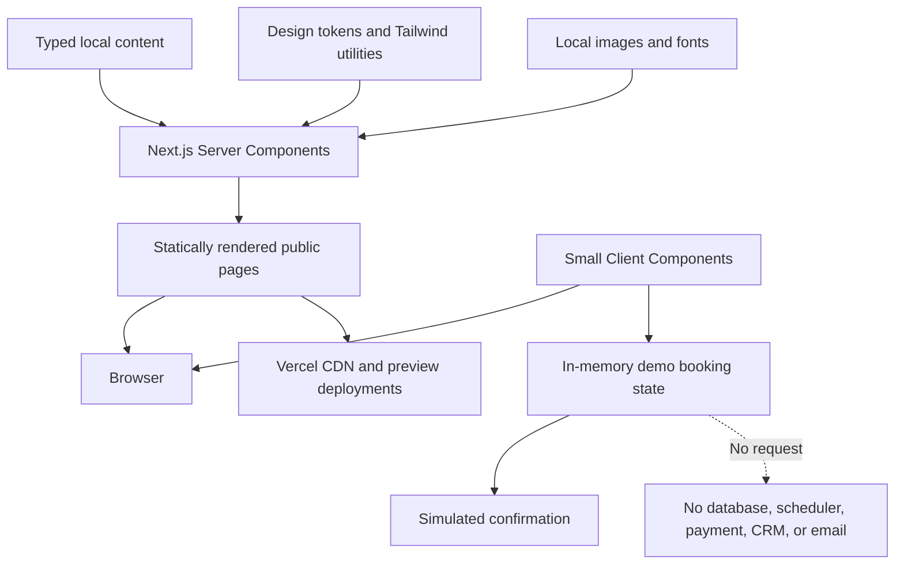
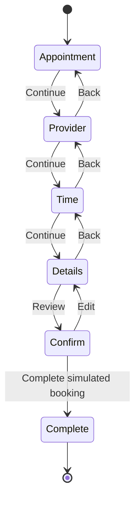

# Juniper House Skin & Aesthetics — Technical Architecture

**Stage:** 11 — Technical Architecture  
**Status:** Locked — 23 August 2026  
**Date:** 22 August 2026  
**Architecture principle:** Static by default, interactive by exception

## Executive decision

Build Juniper House with **Next.js App Router, strict TypeScript, and Tailwind CSS v4**, deployed first to Vercel.

The site will behave like a fast, statically rendered marketing website. React Client Components will be limited to the few features that actually need browser state: the mobile menu, accordions, sticky mobile action, and simulated booking flow.

The portfolio version has no database, authentication, CMS, payment, email, live scheduler, or server-side form submission. All public content lives in typed local files, and the booking demonstration never transmits or permanently stores entered data.

## Why this is the right level of architecture

This project has two products inside it:

1. A commercially credible clinic website
2. A reusable learning and portfolio system for modern custom development

A static HTML site could satisfy the first requirement. A larger full-stack application could satisfy the second while adding unnecessary infrastructure. The selected architecture sits between them: it uses a modern production framework, but it keeps the runtime model intentionally simple.

## Decision snapshot

| Layer | Decision | Reason |
|---|---|---|
| Runtime | Node.js 24 LTS | Current supported LTS line; avoid Current and EOL releases |
| Framework | Latest secure Next.js 16.x App Router patch | Strong public-page, routing, metadata, image, and React composition support |
| Language | TypeScript, `strict: true` | Catch content and state mistakes early; make AI-generated code easier to verify |
| UI | React via Next.js | Shared templates and a focused interactive booking flow |
| Styling | Tailwind CSS v4 plus CSS custom properties | Fast responsive implementation with CSS-first design tokens |
| Package manager | npm | Lowest onboarding friction for this learning project |
| Content | Typed local TypeScript data | No editor or database requirement; version-controlled and reusable |
| Rendering | Static prerendering by default | Fast, searchable pages with little client JavaScript |
| Interactivity | Isolated Client Components | Keep JavaScript proportional to the actual behavior |
| Forms | React state in memory; no submission endpoint | Demonstrate UX without collecting personal or medical data |
| Images | Local assets through `next/image` | Responsive sizing, modern formats, and layout stability |
| Fonts | `next/font` using Newsreader and Manrope | Self-hosted output, no runtime font request, reduced layout shift |
| Icons | Small local SVG set or one tree-shakeable line library | Consistent visual language without a large asset layer |
| Testing | Proportional checks phased through development | Catch problems at the right time without a premature test suite |
| Deployment | Vercel preview and production deployments | Easiest Next.js path; good portfolio preview workflow |
| Analytics | None at first | No real conversion data or consent requirement yet |

## System overview



### Plain-language explanation

- The clinic information is stored in structured files inside the project.
- Next.js turns that content into complete HTML pages during the build.
- Most pages arrive usable before client-side JavaScript runs.
- Only interactive elements receive browser-side React code.
- The booking flow changes local screen state, reaches a simulated confirmation, and stops there.
- Vercel serves the built pages and creates review links during development.

## Rendering strategy

### Server Components by default

Use Server Components for:

- Page layouts and sections
- Home, concern, treatment, consultation, approach, about, visit, and disclosure copy
- Concern and treatment lists
- Quick-facts panels
- Provider and practical-information sections
- Footer and most header content
- Metadata generation

These components do not need the `"use client"` directive. They produce HTML without adding their own component code to the browser bundle.

### Client Components by exception

Use Client Components only for:

- Mobile navigation open/close behavior
- Accessible FAQ accordions, if native `details` is not sufficient
- Sticky mobile booking action state
- Five-step booking demonstration
- Focus movement and announcements between booking steps
- Optional reduced-motion-aware visual transitions that require JavaScript

Each Client Component should be a small interactive island. Do not mark an entire page or root layout as client-side for convenience.

### Static rendering without static export

Public pages have no request-specific data, so Next.js can prerender them. The initial build will use the standard Next.js deployment rather than `output: "export"`.

This keeps:

- Built-in image optimization
- Straightforward metadata and special route files
- Vercel preview deployments
- A simple future path to a real integration

If a future host requires plain static files, `output: "export"` can be evaluated. That change requires testing image loading, redirects, headers, and any future server capability.

## Route architecture

```text
/
/concerns
/concerns/uneven-tone-sun-damage
/concerns/redness-visible-vessels
/concerns/texture-acne-marks
/concerns/fine-lines-facial-balance
/treatments
/treatments/custom-clinical-facial
/treatments/corrective-chemical-peel
/treatments/ipl-photofacial
/treatments/medical-microneedling
/treatments/fractional-laser-resurfacing
/treatments/neuromodulator-treatment
/treatments/hyaluronic-acid-filler
/consultation
/approach
/about
/visit
/book
/portfolio-concept
/medical-disclaimer
/accessibility
/privacy
/terms
```

### Route implementation

- Use one dynamic route template for `/concerns/[slug]`.
- Use one dynamic route template for `/treatments/[slug]`.
- Use `generateStaticParams` so every approved slug is known at build time.
- Return `notFound()` for an unknown slug.
- Keep the core narrative pages as explicit route files because their structures differ.
- Exclude booking and simulated confirmation from search indexing during Stage 15.

## Content architecture

Typed content keeps copy separate from layout while avoiding the complexity of a CMS.

### Treatment model

```ts
type Treatment = {
  slug: string
  name: string
  shortDescription: string
  hero: {
    eyebrow: string
    headline: string
    introduction: string
  }
  quickFacts: {
    price: string
    duration: string
    downtime: string
    course: string
    provider: string
  }
  maySuit: string[]
  mayNotSuit: string[]
  process: Array<{ title: string; body: string }>
  timeline: Array<{ title: string; body: string }>
  alternatives: string[]
  providerStandard: string
  risks: string
  pricing: string
  faqs: Array<{ question: string; answer: string }>
  relatedConcernSlugs: string[]
}
```

### Concern model

```ts
type Concern = {
  slug: string
  name: string
  headline: string
  introduction: string
  notices: string[]
  influences: string
  assessment: string
  pathways: Array<{
    title: string
    description: string
    price?: string
    recovery?: string
    treatmentSlug?: string
  }>
  medicalBoundary: string
  consultationClarifies: string[]
  relatedTreatmentSlugs: string[]
  faqs: Array<{ question: string; answer: string }>
}
```

### Why content is not stored as arbitrary HTML

Structured fields make important content difficult to omit accidentally. Every treatment must provide price, duration, downtime, provider, suitability, risks, alternatives, and FAQs because the type requires them.

This is useful when working with AI: generated copy can be validated against a visible schema instead of pasted into an unstructured page.

### Content validation

At build time, lightweight checks should confirm:

- Every slug is unique.
- Related concern and treatment slugs exist.
- Required quick facts are present.
- No image is missing alt-text intent or a model/proof classification.
- Page titles are unique when metadata is added.
- No booking form code calls an external endpoint.

TypeScript handles structural validation. A small validation script can handle cross-reference and governance checks without adding a CMS.

## Component architecture

### Foundations

- `Container`
- `Section`
- `Stack`
- `Cluster`
- `Grid`
- `Prose`
- `VisuallyHidden`

These are small layout primitives, not a general-purpose component library.

### Global components

- `SiteHeader`
- `MobileNavigation`
- `SiteFooter`
- `PortfolioNotice`
- `Breadcrumbs`
- `MobileBookingAction`

### Content components

- `EditorialHero`
- `QuickFacts`
- `ConcernCard`
- `TreatmentCard`
- `ProcessSteps`
- `ComparisonRows`
- `BoundaryCallout`
- `ProviderProfile`
- `FaqList`
- `FinalCta`
- `ModelImage`

### Booking components

- `BookingShell`
- `BookingProgress`
- `BookingSummary`
- `AppointmentStep`
- `ProviderStep`
- `TimeStep`
- `DetailsStep`
- `ConfirmStep`
- `SimulatedConfirmation`
- `ErrorSummary`

Do not create a component for every decorative wrapper. A component earns its place when it has reused behavior, repeated semantics, a stable design rule, or a meaningful accessibility responsibility.

## Design-system implementation

Tailwind v4 is CSS-first. Put approved tokens in `globals.css` using custom properties and `@theme` where the token should generate utilities.

### Token layers

1. **Raw brand values:** Juniper, Porcelain, Bone, Clay, type families
2. **Semantic values:** background, surface, text, action, boundary, focus, error
3. **Component decisions:** button, input, card, quick-facts panel

Semantic tokens reduce coupling. A button should use `--color-action`, not depend directly on a color name that may change later.

### CSS responsibilities

- `globals.css`: reset, tokens, base typography, focus, selection, reduced motion
- Tailwind utilities: layout, spacing, responsive behavior, most component composition
- Component-level class sets: variants and states
- No Sass or CSS-in-JS layer
- Avoid arbitrary values when an approved token exists

### Variant strategy

Use small TypeScript functions or a focused utility for recurring variants only when needed. Do not add a full styling abstraction before repeated complexity appears.

## Font architecture

Use `next/font` for Newsreader and Manrope so the build outputs self-hosted font assets and avoids runtime requests to Google Fonts.

- Define font variables in the root layout.
- Load only the weights and character sets used.
- Use variable files if supported cleanly by the selected Next.js font integration.
- Set metrics-compatible fallbacks to reduce layout shift.
- Keep Manrope as the form and interface typeface.
- Test Newsreader at mobile sizes, 200% zoom, and slow-font fallback states.

## Image architecture

### Storage

Move approved site assets into descriptive folders under `public/images/` during Stage 12:

```text
public/images/
├── brand/
├── people/
├── clinic/
├── concerns/
└── treatments/
```

### Usage

- Use `next/image` for content imagery.
- Always supply intrinsic dimensions or `fill` with a stable aspect-ratio container.
- Supply accurate `sizes` values so mobile devices do not download desktop-sized images.
- Mark only the real above-the-fold LCP image as priority/preloaded.
- Use meaningful alt text for informative images and empty alt for decoration.
- Keep the visible “Model image” disclosure separate from alt text.

### Image governance

Each image record should state:

- Purpose: context, model, process, environment, or proof
- Source and license
- Consent status where a real person is involved
- Whether it is generated
- Required visible disclosure
- Approved crops

No image is treated as patient proof unless the project later receives verifiable consent and treatment context.

## Booking-demo architecture

### State machine



### State model

```ts
type BookingState = {
  step: "appointment" | "provider" | "time" | "details" | "confirm" | "complete"
  appointmentType: "planning-consultation"
  providerPreference: "first-available" | "rowan-ellis" | null
  date: string | null
  time: string | null
  details: {
    firstName: string
    lastName: string
    email: string
    mobile: string
    concern: string
    accessRequest: string
    smsDemoOptIn: boolean
    demoAcknowledged: boolean
  }
}
```

### State rules

- Keep state inside the booking component using `useReducer`.
- Do not use local storage, cookies, a server action, or an API route.
- A browser refresh clears entered data.
- Mock availability comes from a static deterministic module.
- Completion changes the local state to `complete` and clears personally entered fields as soon as the confirmation summary no longer needs them.
- No calendar file, message, receipt, or analytics event contains the entered values.

### Accessibility behavior

- Use a semantic page heading and ordered progress list.
- Set `aria-current="step"` on the active step.
- Move focus to the new step heading after navigation.
- Provide a concise live-region announcement.
- Show an error summary linked to invalid fields and field-level messages.
- Preserve valid inputs when validation fails.
- Never disable Back.
- The final disclosure appears directly before the completion action.

## Privacy and security posture

The safest portfolio form is one that cannot transmit data.

### Required controls

- No route handler, server action, third-party form endpoint, scheduler embed, or payment script
- No database or persistent browser storage
- No analytics that capture field values or query parameters
- No medical-history fields or photo upload
- Test-data instruction before personal details
- Explicit demo acknowledgment before completion
- `autocomplete` values chosen carefully; use `off` where the demo should not encourage real personal autofill
- No entered details included in the URL
- Content Security Policy and security headers evaluated before deployment
- Dependencies reviewed and kept current

### Important limitation

Client-side code can demonstrate restraint but cannot become a secure medical intake system. A real clinic adaptation would require a compliant vendor and qualified privacy, security, and legal review rather than extending this mock form.

## Accessibility architecture

Accessibility is part of component design, not a final plugin pass.

### Built into foundations

- Semantic landmarks and heading order
- Skip link
- Visible focus and keyboard navigation
- Minimum 44×44px targets; 48px default
- Reduced-motion support
- Sufficient color contrast and non-color status cues
- Form labels, help, errors, and summaries
- Native elements before custom widgets
- Responsive reflow at 200% and 400% zoom
- Dialog-free flow where a normal page region works

### Automated coverage

- ESLint accessibility rules
- Playwright keyboard-flow checks
- `@axe-core/playwright` scans for representative routes and each booking state

### Manual coverage

- Keyboard-only navigation
- VoiceOver on macOS/iOS for the primary journey
- Zoom and text-spacing checks
- Reduced-motion setting
- High-contrast and forced-colors inspection where practical
- Error recovery and focus order

Automated scans do not replace manual accessibility review.

## Performance architecture

### Targets

At the 75th percentile when field data eventually exists:

- LCP: 2.5 seconds or less
- INP: 200 milliseconds or less
- CLS: 0.1 or less

For launch QA, use Lighthouse as a laboratory signal, not a conversion or field-performance claim.

### Performance rules

- Keep public pages Server Component-first.
- No global animation library at launch.
- Avoid video backgrounds and carousels.
- Optimize the hero image and reserve its dimensions.
- Load only approved font weights.
- Avoid third-party scripts until a real need exists.
- Dynamically import only genuinely heavy interactive code.
- Do not preload every image or font.
- Use CSS for visual effects that do not require raster assets.
- Set a review threshold before adding any dependency larger than the feature warrants.

## SEO readiness

Stage 15 will write and implement the final SEO layer, but the architecture reserves:

- Static `metadata` or `generateMetadata` per route
- Canonicals based on the deployed domain
- `sitemap.ts`
- `robots.ts`
- File-based favicon and social images
- Structured data only where the fictional nature can be represented without misleading search engines
- `noindex` for booking, confirmation, error, and preview-only experiences

The fictional clinic should not use local-business structured data in a way that presents it as an operating clinic. Stage 15 must decide whether the public concept should be indexed at all or whether the portfolio domain should frame it clearly as a case study.

## Testing strategy

Testing stays proportional to the maturity of the build.

### Throughout development

- Run TypeScript type checks and ESLint after coherent implementation changes.
- Run a production build at major milestones and before handing off a completed feature group.
- Keep these checks active from the scaffold onward so errors do not accumulate.

### When important interaction logic appears

- Add focused tests for booking reducer transitions, validation, content cross-references, or other logic where a regression would be difficult to spot visually.
- Do not add broad snapshot coverage for static marketing markup.
- Add a unit-test dependency only when these tests are ready to be written, not during initial scaffolding.

### Closer to completion

- Add Playwright for critical end-to-end journeys.
- Add `@axe-core/playwright` with the accessibility test pass.
- Complete manual keyboard, screen-reader, responsive, zoom, reduced-motion, and error-recovery QA.
- Treat automated accessibility scanning as support for—not a replacement for—manual review.

### Critical automated journeys

- Homepage loads and primary CTA reaches booking
- Concern route links to valid treatments and consultation
- Treatment route exposes quick facts and visible risk section
- Mobile navigation opens, traps no focus, and closes predictably
- Booking completes with valid demonstration data
- Booking blocks incomplete or invalid data and preserves valid entries
- Final screen states that no appointment or payment exists
- Representative pages have no automatically detectable axe violations

### Unit tests

Use focused unit tests only for logic that benefits from isolation:

- Booking reducer transitions
- Form validation functions
- Content cross-reference validation
- Mock availability generation

Do not pursue broad snapshot coverage of static markup.

## Deployment architecture

### Environments

- **Local:** development and test
- **Preview:** Vercel deployment for review of each meaningful branch or pull request
- **Production:** public portfolio URL

### Deployment gate

Production deployment requires:

- Clean type check, lint, tests, and build
- Responsive review at agreed breakpoints
- Keyboard and screen-reader smoke test
- No network request from the booking or contact demonstration
- Visible fictional-concept notice and pre-completion disclosure
- Correct indexing policy
- Image license/source log
- No secrets in the repository

### Portability

The project remains a standard Next.js repository. If moved from Vercel:

- Deploy with a compatible Node host and `next start`, or
- Evaluate `output: "export"` for a fully static host

No Vercel-only database, identity, or storage product is part of the launch architecture.

## Workspace boundary

Keep strategy and production code separate inside the shared workspace:

```text
workspace/
├── outputs/    # approved strategy, copy, visual, and architecture artifacts
└── site/       # the deployable Next.js application created in Stage 12
```

Vercel will use `site/` as the project root. This prevents the Next.js scaffold from overwriting the existing `outputs/` archive and keeps client-facing strategy artifacts separate from application dependencies and build files.

## Proposed application structure

```text
site/
├── public/
│   └── images/
│       ├── brand/
│       ├── clinic/
│       ├── concerns/
│       ├── people/
│       └── treatments/
├── src/
│   ├── app/
│   │   ├── (marketing)/
│   │   │   ├── concerns/
│   │   │   │   ├── [slug]/page.tsx
│   │   │   │   └── page.tsx
│   │   │   ├── treatments/
│   │   │   │   ├── [slug]/page.tsx
│   │   │   │   └── page.tsx
│   │   │   ├── consultation/page.tsx
│   │   │   ├── approach/page.tsx
│   │   │   ├── about/page.tsx
│   │   │   ├── visit/page.tsx
│   │   │   └── page.tsx
│   │   ├── book/page.tsx
│   │   ├── portfolio-concept/page.tsx
│   │   ├── medical-disclaimer/page.tsx
│   │   ├── accessibility/page.tsx
│   │   ├── privacy/page.tsx
│   │   ├── terms/page.tsx
│   │   ├── globals.css
│   │   ├── layout.tsx
│   │   ├── not-found.tsx
│   │   ├── robots.ts
│   │   └── sitemap.ts
│   ├── components/
│   │   ├── booking/
│   │   ├── content/
│   │   ├── foundations/
│   │   ├── global/
│   │   └── ui/
│   ├── content/
│   │   ├── concerns.ts
│   │   ├── treatments.ts
│   │   ├── team.ts
│   │   ├── navigation.ts
│   │   └── site.ts
│   ├── lib/
│   │   ├── booking/
│   │   ├── content-validation.ts
│   │   └── metadata.ts
│   └── types/
│       ├── content.ts
│       └── booking.ts
├── tests/
│   ├── e2e/
│   └── unit/
├── .nvmrc
├── next.config.ts
├── package.json
├── playwright.config.ts        # added when end-to-end QA begins
├── postcss.config.mjs
└── tsconfig.json
```

## Dependency policy

### Dependency gate

Before adding any package beyond the approved foundation:

1. Name the exact requirement it solves.
2. Check whether Next.js, React, TypeScript, CSS, or a small local function already solves it adequately.
3. Explain the package’s role in plain English.
4. State the trade-offs: bundle weight, maintenance, security, accessibility, learning cost, and future replacement effort where relevant.
5. Add it only when the benefit is clearer than the cost.

The latest supported, security-patched Next.js 16.x version must be verified at scaffolding time. Do not copy a hardcoded patch version from this document or an old command.

### Launch dependencies

- Next.js, React, and React DOM
- Tailwind CSS and its PostCSS integration
- One small icon source only if local SVGs become inefficient

### Development dependencies

- TypeScript
- ESLint and Next.js rules
- Playwright, added when end-to-end QA begins
- `@axe-core/playwright`, added with the Playwright accessibility checks
- A lightweight unit-test runner only when reducer and validation logic create a demonstrated need

### Deliberately excluded at launch

- Global state libraries
- General animation libraries
- Form framework and schema library
- Component kits that impose a competing visual system
- Headless CMS
- Database client or ORM
- Authentication
- Payment SDK
- Scheduler SDK
- Analytics SDK
- CSS-in-JS and Sass
- Storybook

Exclusion is not a judgment that these tools are bad. It means the current requirement does not justify their maintenance cost.

## Learning map

### Concepts worth understanding during Stage 12

1. **Server versus Client Components:** where code runs and how it affects browser JavaScript
2. **Static rendering:** how typed content becomes ready-to-serve HTML
3. **Dynamic route templates:** one implementation generating several concern or treatment pages
4. **TypeScript schemas:** how types prevent missing content and invalid links
5. **Design tokens:** how visual decisions become CSS variables and reusable utilities
6. **State machines:** how a multi-step booking flow remains predictable
7. **Accessibility semantics:** why structure and focus behavior matter beyond appearance
8. **Deployment previews:** how branches become reviewable URLs

### Concepts intentionally postponed

- Database design
- Authentication and authorization
- Server mutations
- API security
- HIPAA-oriented system architecture
- Content-management workflows
- Payment and scheduling integration

These become useful only when a real client requirement creates a reason to learn them.

## AI-assisted development rules

- Ask AI for small, reviewable components or vertical slices—not the entire website in one prompt.
- Require explanations for new dependencies and `"use client"` directives.
- Treat generated code as a draft that must pass types, lint, tests, and browser QA.
- Keep content and design decisions in the approved source documents so AI does not improvise strategy during implementation.
- Use existing components and tokens before generating new patterns.
- When debugging, reproduce and isolate before replacing large sections.
- Record architecture changes in an ADR when they add infrastructure or materially change the data flow.

## Just-in-time learning rule

Modern development concepts should be introduced when they become relevant to the next implementation step, not explained as a large theory lesson in advance.

When introducing an unfamiliar technology, concept, dependency, command, or architectural decision:

1. Explain what it is in plain English.
2. Explain its role in Juniper House.
3. Explain why it is being used instead of a simpler or common alternative when that distinction matters.
4. State the minimum the user needs to understand before proceeding.
5. Keep the explanation practical and concise unless deeper detail is requested.

Before a major implementation step, explain what will be created, name the important files, and identify choices that affect maintainability, performance, or future changes. After the step, summarize the result, point to the important files, and explain what matters before continuing.

Treat Node.js, npm, React, Next.js, App Router, Server and Client Components, TypeScript, Tailwind CSS, routing, dynamic routes, build tooling, dependencies, state management, testing, deployment, APIs, environment variables, and Git workflows as potentially unfamiliar unless the user demonstrates otherwise.

## Stage 12 implementation sequence

1. Scaffold and verify the empty project.
2. Implement fonts, tokens, base typography, container, and focus styles.
3. Add site shell: concept notice, header, footer, and mobile navigation.
4. Model and validate treatment and concern content.
5. Build the homepage as the first complete vertical slice.
6. Build concern and treatment templates from the typed content.
7. Add consultation, approach, about, visit, and utility pages.
8. Build the booking state machine and all error/confirmation states.
9. Add responsive refinements and image optimization.
10. Add focused automated tests, then perform manual QA.

## Locked decisions

- **Framework:** Latest supported, security-patched Next.js 16.x App Router release verified at scaffolding time
- **Runtime:** Node.js 24 LTS
- **Language:** Strict TypeScript
- **Styling:** Tailwind CSS v4 with CSS-first semantic tokens
- **Rendering:** Static Server Components by default
- **Client boundary:** Mobile navigation, accordions, sticky action, and booking only
- **Content:** Typed local TypeScript modules; no CMS at launch
- **Booking:** In-memory state machine; deterministic mock availability; zero data transmission
- **Hosting:** Vercel first, with documented Next.js portability
- **Package manager:** npm
- **Testing:** Type check, lint, and production builds throughout; focused logic tests when justified; Playwright, axe, and manual QA closer to completion
- **Performance:** Minimal third-party code, optimized local images/fonts, and Core Web Vitals targets
- **SEO foundation:** Next.js Metadata API and file conventions, completed in Stage 15
- **Dependency stance:** Add only after a demonstrated need; no global state, form, animation, CMS, auth, payment, scheduler, or analytics library at launch
- **Architecture source of truth:** `outputs/technical-architecture.md`
- **Decision record:** `outputs/adr-001-technical-foundation.md`
- **Implementation learning rule:** Just-in-time, plain-language explanations before and after major steps

## Sources checked

- [Next.js App Router documentation](https://nextjs.org/docs/app)
- [Next.js support policy](https://nextjs.org/support-policy)
- [Next.js installation and supported environment](https://nextjs.org/docs/app/getting-started/installation)
- [Next.js testing overview](https://nextjs.org/docs/app/guides/testing)
- [Next.js production checklist](https://nextjs.org/docs/app/guides/production-checklist)
- [Next.js metadata and Open Graph guidance](https://nextjs.org/docs/app/getting-started/metadata-and-og-images)
- [Next.js static export guidance](https://nextjs.org/docs/pages/guides/static-exports)
- [Tailwind CSS with Next.js](https://tailwindcss.com/docs/installation/framework-guides/nextjs)
- [Tailwind CSS v4 compatibility](https://tailwindcss.com/docs/compatibility)
- [TypeScript strict mode](https://www.typescriptlang.org/tsconfig/strict)
- [Node.js release status](https://nodejs.org/en/about/previous-releases)
- [Vercel deployment for Next.js](https://vercel.com/docs/frameworks/full-stack/nextjs)
- [Playwright accessibility testing](https://playwright.dev/docs/next/accessibility-testing)
- [Core Web Vitals](https://web.dev/articles/vitals)
